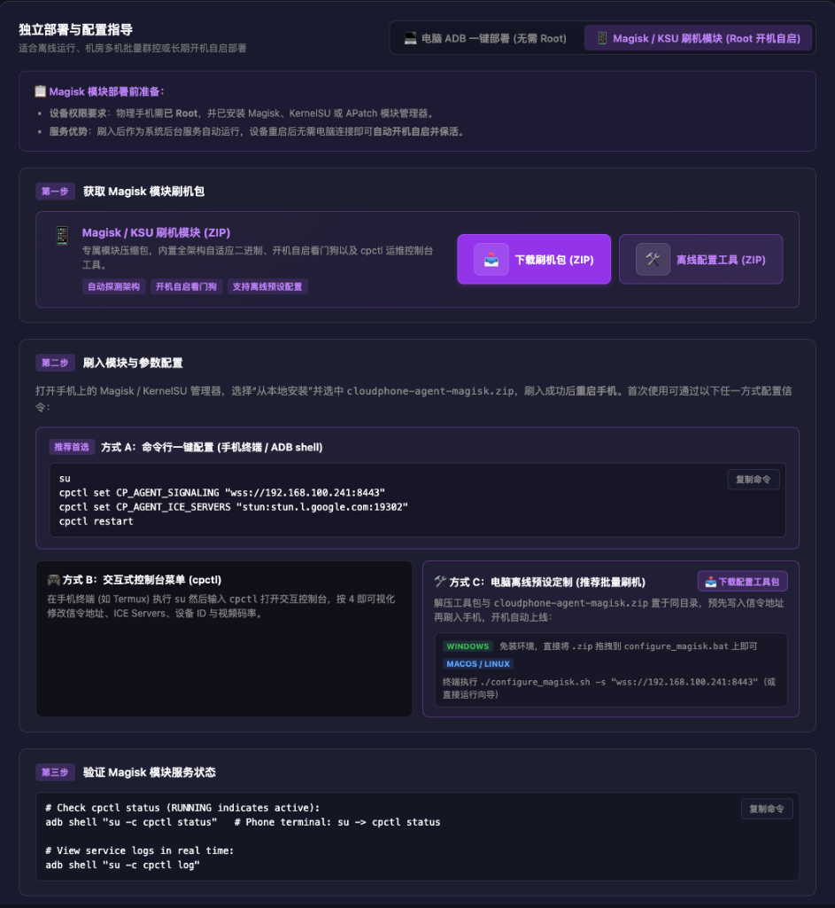
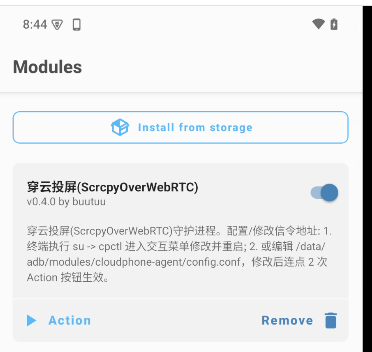
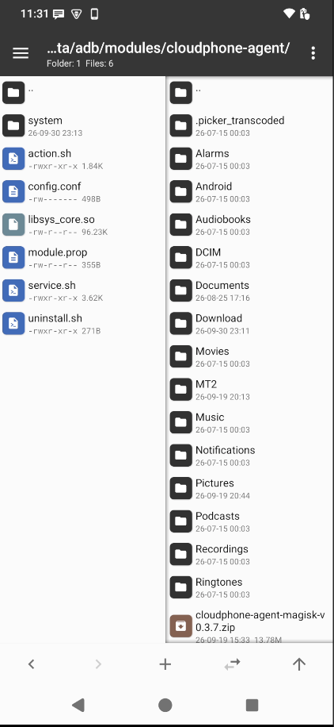
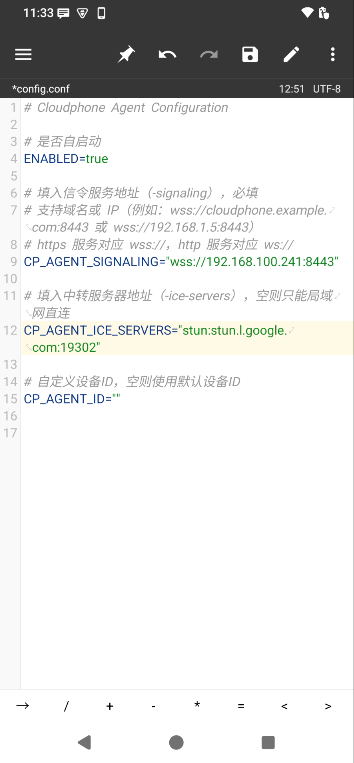

# 方式三：Magisk / Root 模块开机自启 (Root 开机自启)

本指南介绍将 `cloudphone-agent` 封装为 **Magisk / KernelSU / APatch 模块** 刷入 Android 手机的部署方式。  
刷入后 Agent 将作为系统级底层守护服务运行：**开机自动拉起、异常崩溃自动重启**，设备重启后无需电脑连接即可自动上线并保活，非常适合机房批量部署与长期无人值守的物理真机群控。

> 💡 **快捷提示**：在管理控制台的 **`/deploy`（部署）页面** 右下角，或前往 [官方下载中心 (webrtc-phone.com/#download)](https://webrtc-phone.com/#download)，切换至 **“Magisk / KSU 刷机模块 (Root 开机自启)”** 面板（如下图所示），可直接一键下载模块刷机包、离线预配工具，并支持直接点击 **“复制命令”** 在手机终端或电脑端一键配置信令。



---

## 📋 适用场景与前提条件

| 项目 | 要求说明 |
| :--- | :--- |
| **设备权限要求** | 物理手机需已 **Root**，并已激活 Magisk（v24+）、KernelSU 或 APatch 模块管理器 |
| **服务核心优势** | 刷入后作为系统后台服务自动运行，设备重启后无需电脑连接即可自动开机自启并保活 |
| **网络要求** | 手机 Wi-Fi / 网络能够连通云手机服务端的信令地址 |

---

## 🔥 第一步：获取并刷入 Magisk 模块

1. **获取刷机包**：
   - 打开 Web 控制台左侧 **“部署”**（`/deploy`）页面；
   - 在右下角切换到 **“Magisk / KSU 刷机模块 (Root 开机自启)”** 选项卡；
   - 点击 **“下载刷机包 (ZIP)”** 紫色按钮，下载 `cloudphone-agent-magisk.zip`。
2. 将下载的 `cloudphone-agent-magisk.zip` 传输到手机内部存储（可通过微信、手机浏览器下载或电脑 ADB/数据线拷贝）。
3. 打开手机上的 **Magisk / KernelSU / APatch 管理器**。
4. 进入 **「模块」** 页面，点击 **「从本地安装」**，选中该 ZIP 模块包。
5. 刷入完成后，点击右下角 **「重启」** 手机。重启后在模块列表中即可看到已激活的 `穿云投屏(ScrcpyOverWebRTC)` 模块卡片：



模块在安装时会自动完成以下底层适配：
* **架构自适应**：自动探测设备 CPU 架构（`arm64` / `armeabi-v7a` / `x86_64`），安装匹配的原生二进制。
* **系统级守护**：注册系统开机自启脚本，系统启动完成后自动拉起 Agent，并以看门狗巡检保活。
* **运维控制台**：内置 `cpctl`（即 `cloudphone-ctl`）交互式命令行工具。
* **配置平滑备份**：若设备上已存在旧配置，后续覆盖升级刷入时会自动备份并恢复，避免参数被清空。

---

## ⚙️ 第二步：参数配置与上线

手机重启后守护脚本已在后台自动运行。首次使用需将 Agent 指向您的信令服务器地址，以下方式任选其一（控制台页面已动态生成对应命令，支持一键复制）：

### 推荐首选 方式 A：命令行一键配置 (手机终端 / ADB shell)

在手机终端 App（如 Termux / MT 管理器终端）中执行，或电脑连接手机后在 `adb shell` 中执行：

```bash
su
cpctl set CP_AGENT_SIGNALING "wss://<您的服务器IP>:8443"
cpctl set CP_AGENT_ICE_SERVERS "stun:stun.l.google.com:19302"
cpctl restart
```

> 💡 **说明**：
> - 设备 ID 默认由系统根据手机硬件型号及序列号自动匹配分配，无需手动设定。
> - 控制台 `/deploy` 页面的 **“方式 A：命令行一键配置”** 代码框已预填您的当前信令与 ICE 地址，直接点击右侧 **【复制命令】** 即可粘贴运行。

### 方式 B：交互式控制台菜单

在终端中执行 `su` 获取 Root 权限后，直接运行 `cpctl` 打开可视化终端菜单：

```bash
su
cpctl
```

控制台主菜单会展示当前 Agent 运行状态、PID、信令地址与设备 ID；选择 **“4) 交互式修改参数配置”** 即可依次修改信令地址、设备 ID、视频码率及 ICE 服务器，修改后选择 **“3) 重启 Agent 服务”** 生效。

### 方式 C：电脑端离线预设定制（推荐批量刷机预制）

如果您有多台手机需要批量刷机，或不想在手机端/电脑终端敲命令，推荐在**刷入手机前直接在电脑端修改 ZIP 刷机包的预设配置**：

1. **获取离线配置工具**：
   在 Web 控制台的“一键部署 -> Magisk / KSU 刷机模块”页面，直接点击下载 **`magisk-config-tools.zip`**（约 15KB，纯原生支持，无需安装 Python 环境）。
2. **解压工具包**：
   将 `magisk-config-tools.zip` 解压，并与下载的 `cloudphone-agent-magisk.zip` 置于同一文件夹中。
3. **一键定制参数**：
   * **Windows 用户（极简拖拽即用）**：
     直接将 `cloudphone-agent-magisk.zip` **拖拽并放到 `configure_magisk.bat` 图标上**，弹出终端向导，按提示输入信令地址（或回车使用默认值），秒级生成已定制好的 `cloudphone-agent-magisk-configured.zip`；或在 PowerShell 中执行原生免 Python 脚本：
     ```powershell
     .\configure_magisk.ps1 -Signaling "wss://<您的服务器IP>:8443"
     ```
   * **macOS / Linux 用户**：
     在终端运行向导或单行命令：
     ```bash
     chmod +x configure_magisk.sh
     ./configure_magisk.sh -s "wss://<您的服务器IP>:8443"
     ```
4. **手机刷入即连**：
   将生成的定制刷机包传输至手机并在 Magisk / KernelSU / APatch 中刷入，**手机重启后将直接以预设的信令地址自动上线**，完全省去手机端后续敲命令步骤！

### 方式 D：手机端直接编辑配置文件

若您习惯使用手机端图形化文件管理器，可以使用 **MT 管理器** 等具备 Root 权限的应用直接修改配置文件：

1. 打开 MT 管理器，授权 Root 权限后进入模块安装目录：
   ```text
   /data/adb/modules/cloudphone-agent/
   ```



2. 点击打开 `config.conf` 配置文件进行编辑（如下图所示）：



核心配置项说明：
- `ENABLED=true`：后台开机自启与看门狗巡检总开关。
- `CP_AGENT_SIGNALING="wss://<您的服务器IP>:8443"`：**必填**，服务端的信令服务地址。
- `CP_AGENT_ICE_SERVERS="stun:stun.l.google.com:19302"`：STUN / TURN 穿透服务器地址（空则仅支持局域网直连）。
- `CP_AGENT_ID=""`：自定义设备 ID，留空系统将自动根据硬件型号和序列号生成。

3. **秒级热重载生效（免重启手机）**：
   修改保存后无需重启整台手机！只需回到 Magisk / KernelSU 的模块列表，在 `穿云投屏(ScrcpyOverWebRTC)` 卡片上 **连续点击 2 次 `▶ Action` 按钮**（第一次停止、第二次启动），或在手机终端执行 `su -c cpctl restart`，Agent 即可瞬间完成平滑重启并以新配置上线！

---

## 🛠️ cpctl 常用运维命令速查

`cpctl` 所有操作均需 Root 特权（请先执行 `su`）：

| 命令 | 功能作用 |
| :--- | :--- |
| `cpctl start` | 开启保活看门狗并立即启动 Agent 进程 |
| `cpctl stop` | 关闭保活看门狗并立即停止 Agent 进程 |
| `cpctl restart` | 重启 Agent 服务（修改配置后使其生效） |
| `cpctl status` | 查看守护开关状态、Agent 与 Scrcpy 伴生进程 PID、最近运行日志 |
| `cpctl log` | 实时追踪滚动查看运行日志（按 `Ctrl+C` 退出） |
| `cpctl set <键> <值>` | 快速修改配置参数，如 `cpctl set CP_AGENT_BITRATE 8000000` |
| `cpctl config` | 输出当前全部生效配置参数 |
| `cpctl` | 打开交互式终端菜单 |

---

## 📄 配置文件完整参数说明 (config.conf)

文件路径：`/data/adb/modules/cloudphone-agent/config.conf`

| 参数名称 | 默认值 | 说明 |
| :--- | :--- | :--- |
| `ENABLED` | `true` | 保活守护总开关。设为 `false` 时守护脚本将彻底停止巡检且不再自动拉起 |
| `CP_AGENT_SIGNALING` | - | **必填**。信令服务器地址，如 `wss://192.168.1.100:8443` |
| `CP_AGENT_ID` | 自动生成 | 设备唯一 ID，留空则自动取「手机型号-序列号」 |
| `CP_AGENT_BITRATE` | `4000000` | 视频默认码率 (bps)，如 `4000000` 代表 4Mbps |
| `CP_AGENT_RESOLUTION` | 原始尺寸 | 视频分辨率长边（如 `1080`、`720`），留空跟随屏幕原生分辨率 |
| `CP_AGENT_MAX_FPS` | `60` | 最大编码帧率限制（如 `60`、`30`） |
| `CP_AGENT_BWE` | `true` | 开启动态拥塞码率自适应控制 |
| `CP_AGENT_AUDIO` | `true` | 开启设备音频内录采集（需 Android 11+） |
| `CP_AGENT_ICE_SERVERS` | - | 自定义 STUN/TURN 中继服务器（JSON 格式） |
| `CP_AGENT_EXTERNAL_ADDR`| - | 复杂 NAT 环境下用于构造 ICE 候选的外部 IP |
| `CP_AGENT_WEBRTC_PORT` | - | WebRTC 媒体指定 UDP 端口或端口段（如 `50000` 或 `50000-50010`） |
| `CP_AGENT_DEBUG` | `false` | 输出底层详细调试日志 |

---

## 🔍 第三步：验证 Magisk 模块服务状态

在控制台 `/deploy` 页面的 **“第三步 验证 Magisk 模块服务状态”** 中同样提供了一键复制命令。您可在电脑端（通过 ADB）或手机本地终端中验证：

### 1. 检查服务运行状态（RUNNING 代表运行正常）

* **电脑 ADB 执行**：
  ```bash
  adb shell "su -c cpctl status"
  ```
* **手机本地终端执行**：
  ```bash
  su
  cpctl status
  ```

输出中只要显示 **Agent Process: RUNNING** 且 **Scrcpy Helper: RUNNING**，即代表模块已成功自启并在后台稳定保活。此时即可拔除数据线，在 Web 控制台的“大盘”或“虚机”中直接开始远程控制。

### 2. 实时查看服务运行日志

若需排查连接或查看详细工作日志，可执行实时日志追踪：
```bash
adb shell "su -c cpctl log"
```
*(手机终端直接执行 `su -c cpctl log`，按 `Ctrl+C` 可退出实时追踪)*

---

## 🛑 手机内快速断开与停止 Agent

如果您手边没有电脑，需要直接在手机上快速断开当前的远程投屏连接：

* **方式一 (推荐)**：在手机本地自带浏览器中打开：
  ```text
  http://127.0.0.1:12345/d
  ```
  页面提供一键切断当前远程画面（保持 Agent 待命）或彻底退出 Agent 服务的可视化按钮。
* **方式二 (终端命令)**：在 Termux 等 Root 终端中执行 `su -c "cpctl stop"`。

---

## ♻️ 升级与卸载

- **平滑升级**：直接在 Magisk / KSU 中重新刷入新版 `cloudphone-agent-magisk.zip` 并重启，原有的 `config.conf` 配置会自动保留。
- **彻底卸载**：在模块列表中点击“移除”并重启手机，系统守护脚本与临时文件将被全部清理。
