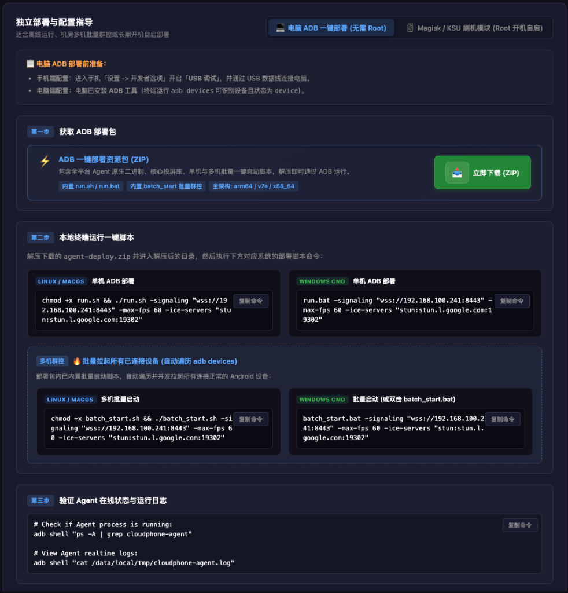
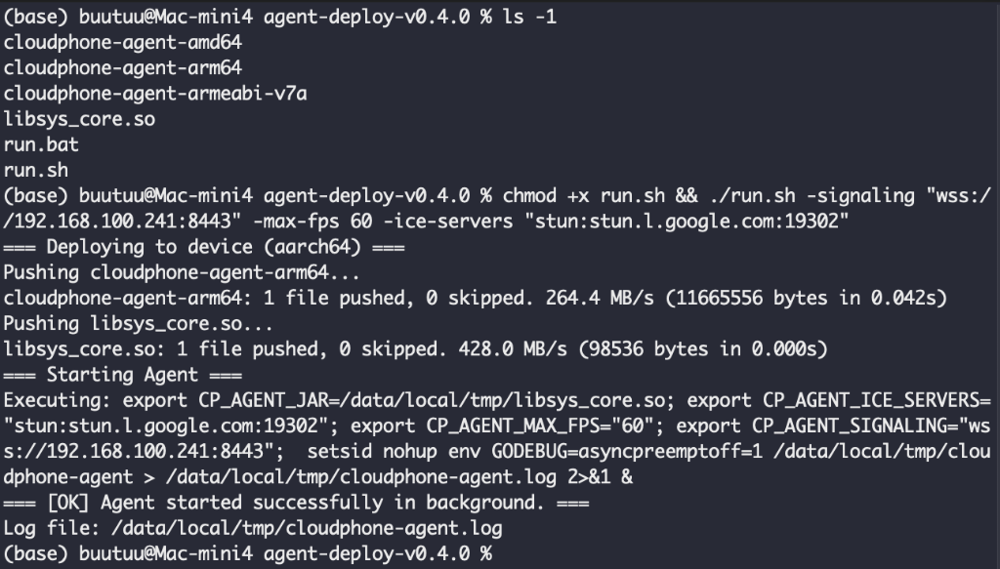

# 方式二：电脑 ADB 脚本一键部署 (无需 Root)

如果您熟悉命令行操作、需要在内网批量接入多台手机进行群控，或者希望通过**无线网络 ADB (TCP/IP)** 接入设备，推荐使用官方的电脑端一键部署资源包 `agent-deploy.zip`。

> 💡 **快捷提示**：在管理控制台的 **`/deploy`（部署）页面** 右下角，或直接前往 [官方下载中心 (webrtc-phone.com/#download)](https://webrtc-phone.com/#download)，您可以直接一键下载该资源包。管理控制台还为您**动态组装好对应当前服务器网络环境的部署命令**，支持直接点击 **“复制命令”** 在本地终端粘贴执行，无需手动拼写参数。

---

## 📋 适用场景与前提条件

| 项目 | 要求说明 |
| :--- | :--- |
| **适用系统** | Windows (10/11)、macOS (Intel/Apple Silicon)、Linux (Ubuntu/Debian/CentOS 等) |
| **环境要求** | 电脑上已安装 ADB 命令行工具（终端输入 `adb version` 可正常输出） |
| **连接方式** | 支持 USB 有线连接，或通过 `adb connect <手机IP>:5555` 建立的无线网络连接 |

---

## ⚡ 详细操作步骤

### 第 1 步：在控制台获取部署包与复制命令
1. 打开 Web 管理控制台（如 `https://<您的服务器IP>:8443` 或 `http://localhost:8443`）。
2. 在左侧菜单栏点击 **“部署”**（路由为 `/deploy`），进入部署页面。
3. 在页面右下角找到 **“独立部署与配置指导”** 区域，默认处于 **“电脑 ADB 一键部署 (无需 Root)”** 面板（如下图所示）。
4. 点击第一步中的 **“立即下载 (ZIP)”** 绿色按钮，下载 `agent-deploy.zip` 并解压到电脑任意目录。



解压后的目录文件结构如下：
```text
agent-deploy/
├── cloudphone-agent-arm64       # Android 64位 Agent 原生二进制
├── cloudphone-agent-armeabi-v7a # Android 32位 Agent 原生二进制
├── cloudphone-agent-amd64       # Android x86_64 容器/模拟器 Agent
├── libsys_core.so               # 深度定制的 scrcpy-server 投屏核心
├── run.sh                       # Linux / macOS 单机部署脚本
├── run.bat                      # Windows CMD 单机部署脚本
├── batch_start.sh               # Linux / macOS 多机批量启动脚本 (群控专享)
└── batch_start.bat              # Windows 多机批量启动脚本 (双击即用)
```

### 第 2 步：连接手机并核实 ADB 状态
确保手机已开启开发者模式与 USB 调试，使用数据线连接电脑后，在终端执行：
```bash
adb devices
```
确认列表中已列出目标设备，且状态显示为 `device`。

*(若使用局域网无线调试，请先在手机开启无线调试并在电脑终端执行 `adb connect <手机IP>:5555`)*

### 第 3 步：一键复制命令并在终端运行

在控制台 `/deploy` 页面的 **“第二步 本地终端运行一键脚本”** 中，系统已根据您当前服务的 IP/域名及 ICE 配置动态生成好了完整指令。您可以直接点击代码框右上角的 **【复制命令】** 按钮，然后在解压目录下的终端中粘贴执行：

#### 场景 A：单台设备接入（推荐）

* **Linux / macOS**：
  ```bash
  chmod +x run.sh && ./run.sh -signaling "wss://<您的服务器IP>:8443" -max-fps 60 -ice-servers "stun:stun.l.google.com:19302"
  ```
* **Windows (CMD)**：
  ```cmd
  run.bat -signaling "wss://<您的服务器IP>:8443" -max-fps 60 -ice-servers "stun:stun.l.google.com:19302"
  ```

#### 场景 B：多机批量并发拉起（自动遍历所有已连接设备）

如果您连接了多台手机进行群控，直接使用内置的批量启动脚本：

* **Linux / macOS**：
  ```bash
  chmod +x batch_start.sh
  ./batch_start.sh -signaling "wss://<您的服务器IP>:8443" -max-fps 60 -ice-servers "stun:stun.l.google.com:19302"
  ```
* **Windows**：
  直接**双击 `batch_start.bat`** 即可弹出向导输入信令地址一键全量拉起；或在 CMD 执行：
  ```cmd
  batch_start.bat -signaling "wss://<您的服务器IP>:8443" -max-fps 60 -ice-servers "stun:stun.l.google.com:19302"
  ```

> 💡 **核心参数解析**：
> - `-signaling <信令地址>`：必填。指向服务端信令服务 WebSocket 地址（如 `wss://192.168.100.241:8443`）。
> - `-max-fps <帧率>`：可选。视频推流最大帧率（默认 60 帧）。
> - `-ice-servers <STUN/TURN>`：可选。WebRTC NAT 穿透服务器地址（默认使用 Google STUN 或您的私有 STUN/TURN）。
> - 设备 ID（`-id`）默认无需指定，脚本与服务会自动根据设备底层型号与序列号匹配分配，即插即用。

### 第 4 步：脚本自动化流程与验证

执行脚本后，终端将自动完成架构探测、文件推送、权限授予与后台脱离终端守护拉起：



对照上图输出，脚本完整执行流水线包含：
1. **架构探测**：自动识别手机底层 ABI（如 `aarch64` / `arm64`）；
2. **极速推送**：通过 ADB 向手机 `/data/local/tmp/` 目录推送匹配架构的 `cloudphone-agent` 与 `libsys_core.so` 投屏核心；
3. **静默拉起**：自动配置 `chmod 755` 权限，并通过 `setsid nohup` 在后台拉起守护进程并打印启动成功的 PID；
4. 终端提示 `=== [OK] Agent started successfully in background. ===`，并注明日志落盘路径 `/data/local/tmp/cloudphone-agent.log`。

此时您已可以**安全拔掉物理 USB 数据线**。返回浏览器 Web 控制台的“大盘”或“虚机”页面，即可看到该手机已在线上线，点击卡片直接开启低延迟直控！

---

## 🛑 停止与断开 Agent 服务

* **方式一（手机内直接断开）**：
  在手机自带浏览器中直接打开：
  ```text
  http://127.0.0.1:12345/d
  ```
  即可一键切断当前远程画面（保持 Agent 待命），或点击彻底退出 Agent 进程。
* **方式二（电脑 ADB 命令）**：
  在电脑终端运行以下命令强制清理后台进程：
  ```bash
  adb shell "pkill -f cloudphone-agent && pkill -f libsys_core.so"
  ```

---

## ➡️ 其他接入方式

- [方式一：网页端 WebUSB 一键部署 (免装 ADB)](/agent-webusb)
- [方式三：Magisk / Root 模块开机自启 (长期无人值守)](/agent-magisk)
- [方式四：Android App 原生客户端 (手机直接运行)](/app-guide)
