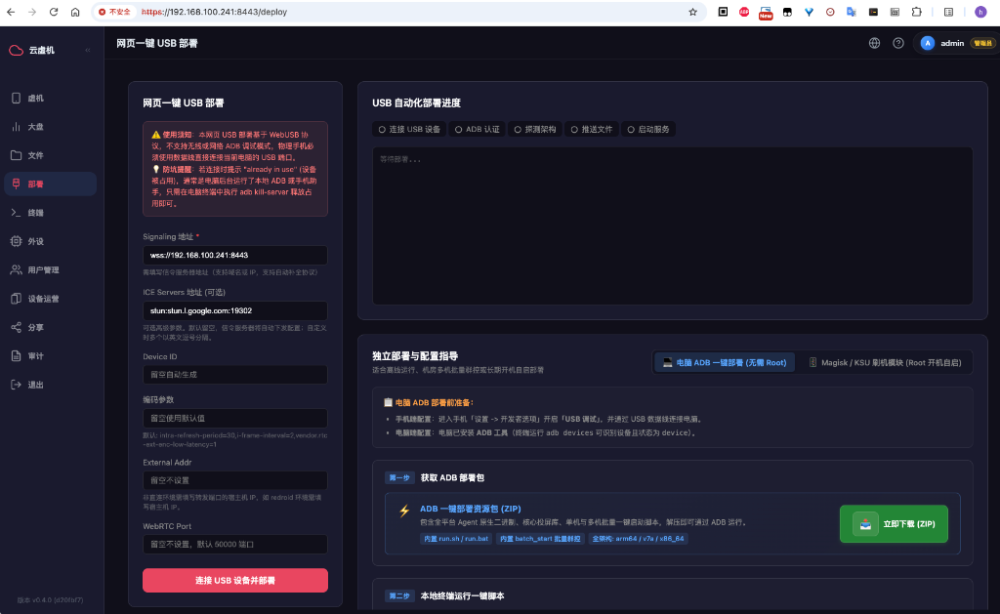
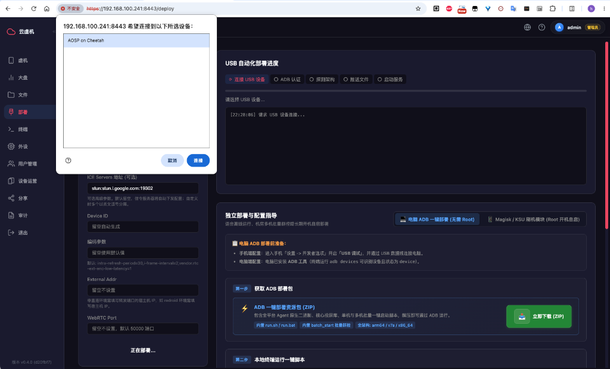
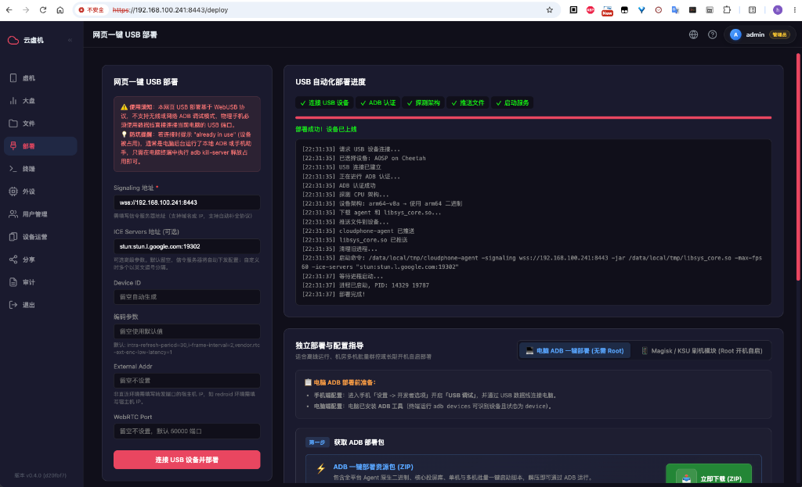

# 方式一：网页端 WebUSB 一键部署 (WebUSB Setup)

本项目控制台内置了基于现代浏览器 **WebUSB API + 纯前端 WebADB** 的零依赖自动化部署流水线。  
用户**无需在电脑上配置或安装任何 ADB 环境**，只需使用 Chrome / Edge 浏览器打开控制台，插入 USB 数据线即可一键完成手机端 Agent 的自动识别、静默推送与后台拉起。

---

## 📋 适用场景与前提条件

| 项目 | 要求说明 |
| :--- | :--- |
| **适用设备** | 所有已开启 USB 调试的 Android 物理真机（免 Root） |
| **浏览器要求** | Google Chrome 89+、Microsoft Edge 89+ 或 Chromium 内核浏览器（Safari 与 Firefox 暂不支持 WebUSB 标准） |
| **访问协议** | 必须通过 **`https://`** 加密协议或本机 **`http://localhost`** 访问控制台（浏览器沙箱安全上下文要求） |
| **电脑 ADB 占用** | 部署前请确保电脑上的其他手机助手（如 360 手机助手、各种模拟器助手）已退出，避免物理 USB 接口被抢占 |

---

## ⚡ 详细操作步骤

### 第 1 步：连接手机与电脑
1. 确保手机已完成 [设备接入准备](/agent-prep) 中的设置（开启 USB 调试及安全权限）。
2. 使用 USB 数据线将手机与电脑连接。

### 第 2 步：打开 Web 控制台部署页
1. 在浏览器中打开云手机控制台（如 `https://<您的服务器IP>:8443` 或 `http://localhost:8443`）。
2. 在左侧菜单栏点击 **“部署”** 菜单（页面地址 `/deploy`），进入 **“网页一键 USB 部署”** 页面。



3. 页面左侧为部署配置参数区（通常保持默认即可）：
   - **Signaling 地址（必填）**：系统会自动填入当前控制台的信令服务地址（如 `wss://192.168.100.241:8443`），支持域名或 IP。若您通过反向代理或公网访问，请确认手机能连通该地址。
   - **ICE Servers 地址（可选）**：默认预填 STUN 地址（如 `stun:stun.l.google.com:19302`），用于 WebRTC NAT 穿透。局域网环境通常保持默认即可。
   - **Device ID（可选）**：留空系统将自动生成随机设备 ID；多设备管理时也可手动指定容易识别的名称。
   - **编码参数 / External Addr / WebRTC Port**：高级调优参数，常规使用留空即可（留空使用系统默认最佳参数）。

### 第 3 步：点击“连接 USB 设备并部署”与设备双重授权
1. 确认手机已用数据线连接电脑，点击左侧底部的粉红色按钮 **【连接 USB 设备并部署】**。
2. **电脑端浏览器授权**：
   - 点击后，按钮状态变为 **“正在部署...”**，右侧进度面板的第一步 **“连接 USB 设备”** 指示灯激活，控制台打印 `[时间] 请求 USB 设备连接...`；
   - 浏览器顶部将弹出 WebUSB 物理设备选择浮层（如下图所示）；
   - 在列表中点击选中您的 Android 设备（如 `AOSP on Cheetah` 等设备型号），右下角的 **“连接”** 按钮变亮，点击 **“连接”**。



3. **手机端 USB 调试授权**：此时手机屏幕上会弹出 **“允许 USB 调试吗？”**（可能附带 RSA 密钥指纹），务必勾选 **“一律允许使用这台计算机进行调试”**，并点击 **“允许”**。

> 💡 **防坑提醒（端口抢占报错）**：若点击连接后控制台提示 `USB 设备被其他程序占用` 或 `already in use`，通常是电脑后台运行了本地 ADB 服务（如 Android Studio、VSCode 调试进程）或第三方手机助手抢占了物理 USB 端口。只需在电脑终端执行 `adb kill-server` 并彻底退出其他手机助手，然后重新点击部署即可。

### 第 4 步：全自动流水线部署（单键直达，无需二次操作）
设备授权通过后，系统将自动进入零干预部署流水线。右侧 **“USB 自动化部署进度”** 面板将依次推进并点亮 5 阶段绿色指示灯：
1. **连接 USB 设备**：建立底层 WebUSB 物理数据传输通道；
2. **ADB 认证**：完成 WebADB 协议身份验证与握手；
3. **探测架构**：自动读取手机底层 CPU 架构（如 `arm64-v8a`、`armeabi-v7a`、`amd64` 等）；
4. **推送文件**：自动从信令服务器下载对应架构的 `cloudphone-agent` 二进制与 `libsys_core.so` 投屏核心，写入手机 `/data/local/tmp/` 目录；
5. **启动服务**：自动配置 `chmod 755` 权限，并通过 `setsid nohup` 在 Android 后台脱离终端静默拉起 Agent 并向信令服务器注册上线。

下方黑色控制台区域会实时滚动输出详细日志。当 5 个指示灯全部转为绿色对勾、进度条填满（100%）、状态提示绿色 **“部署成功! 设备已上线”** 时，即表示部署流程全部顺利完成。



### 第 5 步：拔掉数据线，开始无线操控
1. 部署成功后，Agent 已在手机后台独立常驻运行。
2. 此时您可以**直接拔掉 USB 数据线**，手机与电脑之间无需保持有线连接。
3. 点击左侧菜单栏的 **“大盘”** 或 **“虚机”**，即可在设备矩阵中看到刚上线的手机卡片，点击卡片即可开启超低延迟的 WebRTC 远程投屏与触控！

> 💡 **手机端快速断开技巧**：拔掉数据线后，若您希望在手机上直接主动断开远程连接，只需在手机自带浏览器中打开 `http://127.0.0.1:12345/d`，即可一键切断当前远程画面或彻底退出 Agent 进程。

---

## ❓ 常见问题排查

**Q：提示“错误：The device is already in use by another program”或“Unable to claim interface”？**
- **原因**：WebUSB 需要独占访问手机的物理 USB 接口。如果电脑后台正在运行本地的 `adb server`（例如 Android Studio、VSCode 调试器、各种模拟器助手、360手机管家等），该进程会强占 USB 端口，导致浏览器无法获取设备控制权。
- **解决方案**：
  1. 打开电脑上的命令行终端（Windows 用户按 `Win+R` 输入 `cmd`，macOS 打开“终端”）；
  2. 执行以下命令杀掉本地的 ADB 守护进程：
     ```bash
     adb kill-server
     ```
  3. 彻底退出电脑托盘中的其他安卓助手或模拟器软件；
  4. 回到浏览器，重新点击 **“连接并授权设备”** 即可秒级连通！

**Q：点击“连接并授权设备”后，浏览器弹窗内找不到我的手机？**
1. 检查数据线是否牢固连接，尝试更换电脑 USB 接口（推荐插在机箱后置 USB 接口）。
2. 检查手机是否弹出授权框，是否开启了开发者选项与 USB 调试。
3. 检查电脑后台是否有占用 5037 端口的 ADB 进程或其他安卓手机管家，若有请执行 `adb kill-server`。

**Q：推送成功但设备列表一直不显示上线？**
1. 确认手机所连接的 Wi-Fi 与信令服务器之间网络是否互通。
2. 如果信令服务器运行在局域网内，请确认手机没有开启代理或 VPN 干扰内部路由。
3. 小米手机用户请检查是否开启了 **「USB 调试（安全设置）」**。

---

## ➡️ 其他接入方式

- [方式二：电脑脚本一键包接入 (命令行/无线ADB)](/agent-script)
- [方式三：Magisk / Root 模块开机自启 (长期无人值守)](/agent-magisk)
