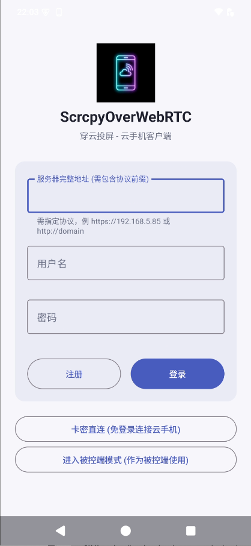
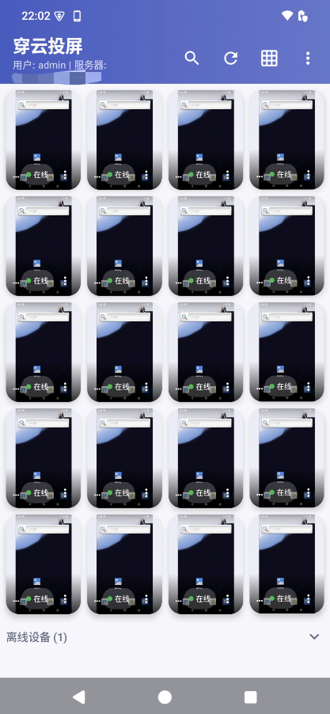
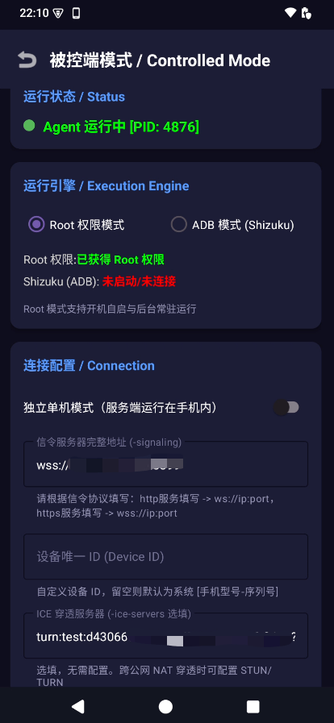
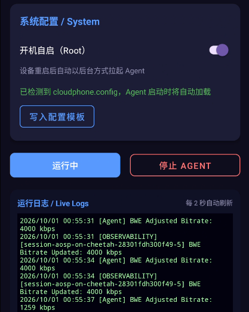

# 方式四：Android App 原生客户端 (App Guide)

官方 Android 原生客户端 **「穿云投屏」**（工程代号 `WebrtcTest`）集 **主控端** 与 **被控端** 于一身，支持在 Android 手机与平板上随时操控云手机或将本机作为被控端使用。

* **作为主控端 (Controller)**：直接登录云手机信令中心，随时随地在手机屏幕上浏览大盘并低延迟控制其他设备；支持卡密免登录直连。
* **作为被控端 (Agent Host)**：无需借助电脑，通过 **Root 提权** 或 **Shizuku (免 Root ADB)** 引擎在手机内直接拉起 Agent 成为被控云手机；开启独立单机模式后，甚至能将信令服务端与 Web 控制台直接运行在本机。

---

## 📥 安装 App

前往 [Releases](https://github.com/hqw700/ScrcpyOverWebRTC/releases) 页面下载最新版 CloudPhone App (`.apk`) 并安装到您的 Android 手机上。

> 💡 **零外部依赖**：App 内部已打包集成各架构编译好的 Agent 原生程序及投屏组件，运行被控端模式时**无需向手机推送任何外部文件**。

---

## 🎮 一、主控端模式：在手机上操控云端设备

### 1. 登录与连接

打开 App 后即可看到登录与功能入口界面（如下图所示）：



1. **常规账号登录**：
   - **服务器完整地址**：需包含协议前缀，如 `https://192.168.100.241:8443` 或您的自定义域名；
   - **用户名与密码**：默认为管理员账号 `admin` / `admin123`（与 Web 控制大盘共用用户体系，也支持直接点击“注册”创建普通租户账号）；
   - 点击 **“登录”** 按钮即可登入控制中心。
2. **快捷入口**：
   - **卡密直连 (免登录连接云手机)**：租户/客户可输入管理员生成的 8 位卡密（如 `CP-XXXX-XXXX`）直接开控对应云手机，无需注册或输入用户名密码；
   - **进入被控端模式 (作为被控端使用)**：直接将当前手机转为被控端云机，免去主控登录。

### 2. 移动端大盘监控与设备矩阵

登录成功后，即可直接进入移动端专享的实时设备监控大盘：



- **多路高密矩阵预览**：支持自适应 4 列网格矩阵，实时同步每台云手机的画面流与在线状态（绿色在线胶囊标签）；
- **便捷工具栏**：顶栏提供关键词搜索（🔍）、一键刷新（🔄）、网格视图切换（田）以及更多设置；
- **状态分组**：底部支持一键折叠查看离线设备列表；
- **点击秒连**：点击任意正在运行的云手机卡片，即可建立 WebRTC 超低延迟 P2P 直连，直接进入全屏触控视窗。

### 3. 核心交互与低延迟控制
进入单机控制视窗后，支持专为触屏优化的丰富功能：
- **多点触控与坐标逆映射**：触控手势自适应缩放；设备在横竖屏动态旋转时，画面在 OpenGL 层旋转 90° 贴合，触控坐标自动逆变换。
- **端到端延迟悬浮球**：悬浮球每秒根据 RTT、Jitter Buffer 延迟和解码时间实时估算端到端综合延迟，按 `<50ms` (绿) / `<100ms` (黄) / 红色动态着色。
- **金刚键与系统菜单**：居中悬浮控制栏提供返回、HOME、多任务（Recents）金刚键，以及电源、音量加减等物理按键。
- **中文输入与远端键盘抑制**：进入键盘输入模式后，本地输入法落词后才统一注入；同时向远端动态注册虚拟物理键盘，自动抑制远端 Android 屏幕弹出软键盘挡住画面。
- **摄像头视频流回传**：支持开启本机摄像头并将其作为 WebRTC 视频流回传给云手机，供虚拟相机驱动消费。

### 4. 后台保活与无感自愈
主控连接退至后台后，App 单例连接管理器将启动 10 分钟保活倒计时；退后台期间仅暂停渲染，切回前台瞬间恢复；网络波动导致 ICE 中断时会静默无感重连。

---

## 📲 二、被控端模式：将手机变为受控云手机

在 App 登录页或设备列表页点击 **“进入被控端模式”**，即可将当前物理手机作为被控端挂载到信令服务器，供电脑或其它手机随时远程操控。



### 1. 选择运行引擎（二选一）

| 引擎类型 | 适用设备 | 原理与能力 |
| :--- | :--- | :--- |
| **Root 权限模式** | 已 Root 设备 (Magisk / KernelSU / APatch) | 通过 `su` 提权运行，**支持开机自动上线、后台常驻守护与离线配置文件批量预设**，权限完整度最高 |
| **ADB 模式 (Shizuku)** | **未 Root 的普通设备** | 借助 Shizuku 框架以 `shell` (UID 2000) 身份运行，ADB 权限原生具备屏幕录制与触控注入能力，**完全免 Root** |

> 💡 **Shizuku 模式准备步骤**：安装并激活 [Shizuku](https://shizuku.rikka.app/)（Android 11+ 可直接在手机「无线调试」中配对激活，免电脑）；回到 App 选择“ADB 模式 (Shizuku)”并授权即可。

### 2. Root 模式：开机自动上线与批量配置文件



针对机房机架批量部署或长期无人值守设备，Root 模式提供了两项核心能力：

#### ① 开机自启动上线 (Root)
在“系统配置 / System”区域打开 **“开机自启 (Root)”** 开关：
- 设备每次开机或重启后，系统守护模块均会**在后台全自动拉起 Agent 并向信令服务器注册上线**；
- 手机端无需插数据线、无需连接电脑、无需人工打开 App 点击，真正实现 7x24 小时无人值守。

#### ② 批量预设配置文件 (`/data/local/tmp/cloudphone.config`)
为了解决多台设备逐一输入信令地址效率低的问题，App 支持通过配置文件直接驱动：
- **单机一键生成**：在 App 界面点击 **【写入配置模板】**，系统将自动在手机中生成模板文件，界面提示绿色的 `已检测到 cloudphone.config，Agent 启动时将自动加载`；
- **批量批量预制（机房推荐）**：批量刷机或部署时，只需通过脚本将配置文件推送到手机目录：
  ```text
  /data/local/tmp/cloudphone.config
  ```
  文件格式示例：
  ```bash
  CP_AGENT_SIGNALING="wss://192.168.100.241:8443"
  CP_AGENT_ICE_SERVERS="stun:stun.l.google.com:19302"
  CP_AGENT_ID=""
  ```
  当该文件存在时，Agent 启动时将自动优先加载其中的信令与网络参数，完全跳过手动输入，实现批量手机秒级全自动上线！

### 3. 配置参数与手动启动
1. **信令服务器完整地址**：填入您的信令服务器地址（如 `wss://192.168.100.241:8443`）；
2. **设备唯一 ID**：自定义在大盘中显示的名称，留空则自动按 `[手机型号-序列号]` 生成；
3. **ICE 穿透服务器**：选填，跨公网或复杂 NAT 时可填入 STUN/TURN 地址；
4. 点击 **“启动 Agent”**。

顶部状态区将显示绿色的 **`Agent 运行中 [PID: xxxx]`**，下方“运行日志 / Live Logs”每 2 秒自动刷新底层推流与 BWE 码率自适应日志。此时打开 Web 控制台大盘，该手机即可正常出流控制！

---

## 🏠 三、独立单机模式（手机内自建服务）

在被控端界面勾选 **“独立单机模式”** 后，App 会将信令服务器（`webrtc-signaling`）与 Web 前端一并启动在手机内部。

1. 手机连接局域网 Wi-Fi 后，点击 **“启动 Server & Agent”**；
2. 界面会展示本机局域网 IP 与 **HTTPS 外部直连地址**（如 `https://192.168.1.120:8443`）；
3. 同一局域网内的任何电脑、平板或手机打开该网址，即可直接进入控制台操控这部手机，**完全不依赖任何外部服务器或 PC**。

---

## ❓ 常见问题排查

**Q：App 切到后台后被控 Agent 经常掉线？**
由于部分国产手机系统对后台进程管理较为激进，请在手机「设置」中将穿云投屏 App 加入 **「电池优化白名单」** 并开启 **「允许后台自启动」**。对于长期无人值守的真机群控场景，强烈建议采用 [Magisk 模块方案](/agent-magisk)。

**Q：手机被远程控制时有安全提示吗？**
出于 Android 系统安全规范，在投屏录制期间，通知栏会常驻显示录屏监控状态，并可随时点击断开。
