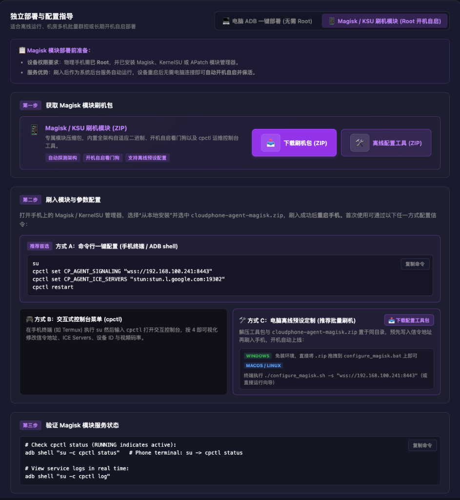
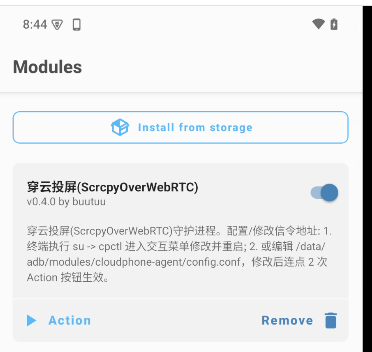
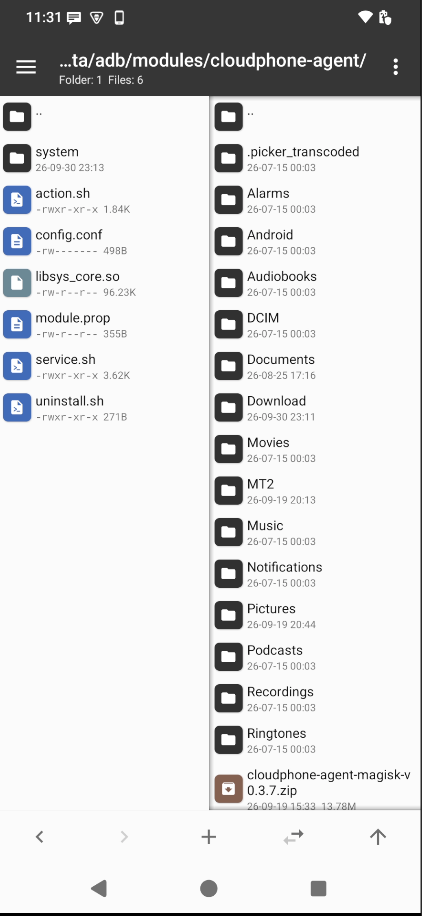
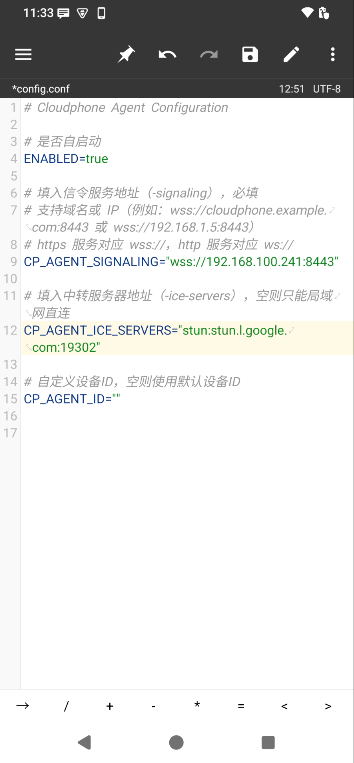

# Method 3: Magisk / Root Auto-Start Module (Root Persistent Daemon)

This guide covers installing `cloudphone-agent` as a **Magisk / KernelSU / APatch module** on rooted Android devices.  
Once installed, the Agent operates as a persistent system-level daemon: **it launches automatically on device boot and recovers from unexpected process terminations**, requiring no computer connection. It is ideal for unattended device racks, server farms, and 24/7 automated mobile clusters.

> 💡 **Quick Tip**: On the **`/deploy` page** of the web console, or directly at the [Official Download Center (webrtc-phone.com/#download)](https://webrtc-phone.com/#download), switch to the **"Magisk / KSU Module (Root Auto-Start)"** panel (shown below) to download the flashable module package and offline configuration tools with one click, or directly click **"Copy Command"** to configure signaling in your terminal.



---

## 📋 Scenarios & Prerequisites

| Item | Requirement |
| :--- | :--- |
| **Device Privilege** | The physical phone must be **Rooted** with Magisk (v24+), KernelSU, or APatch installed and active |
| **Core Advantage** | Runs as an autonomous system daemon; device reboots automatically start the Agent without PC connection |
| **Network** | The phone's Wi-Fi or cellular network must have connectivity to the signaling server |

---

## 🔥 Step 1: Download & Flash the Module

1. **Get the Module ZIP**:
   - Open the Web Console and click **"Deploy"** (`/deploy`) in the left sidebar;
   - Switch to the **"Magisk / KSU Module (Root Auto-Start)"** tab in the bottom-right panel;
   - Click the purple **"Download Module (ZIP)"** button to get `cloudphone-agent-magisk.zip`.
2. Transfer `cloudphone-agent-magisk.zip` to the phone's internal storage (via USB, browser download, or messaging tools).
3. Open your **Magisk / KernelSU / APatch Manager** app.
4. Go to the **"Modules"** section, tap **"Install from storage"**, and select the ZIP file.
5. Once installation completes, tap **"Reboot"** in the lower-right corner. After rebooting, the activated `穿云投屏(ScrcpyOverWebRTC)` module card will appear in the modules list:



During installation, the module automatically handles:
* **Architecture Detection**: Identifies device CPU architecture (`arm64`, `armeabi-v7a`, or `x86_64`) and installs the matching native binary.
* **System-Level Watchdog**: Installs an init boot script that launches the Agent upon network readiness and polls to ensure health.
* **CLI Management**: Installs the `cpctl` (`cloudphone-ctl`) interactive command-line tool.
* **Seamless Backup**: Existing configurations are automatically preserved when flashing newer versions.

---

## ⚙️ Step 2: Configuration & Service Start

After rebooting, the watchdog daemon runs in the background. On initial setup, point the Agent to your signaling server using one of the following methods (commands are pre-generated on the console `/deploy` page):

### Recommended Method A: One-Line CLI Command (Phone Terminal / ADB Shell)

In a terminal app on the phone (Termux / MT Manager Terminal) or via PC `adb shell`:

```bash
su
cpctl set CP_AGENT_SIGNALING "wss://<YOUR-SERVER-IP>:8443"
cpctl set CP_AGENT_ICE_SERVERS "stun:stun.l.google.com:19302"
cpctl restart
```

> 💡 **Notes**:
> - Device ID is assigned automatically by default based on device hardware model and serial number; specifying manually is optional.
> - The **"Method A: Command Line Setup"** card on the web console `/deploy` page pre-fills your active signaling and STUN endpoints. Simply click **[Copy Command]** on the right to paste and execute.

### Method B: Interactive Terminal Menu

Run `su` followed by `cpctl` to open the terminal management menu:

```bash
su
cpctl
```

The menu displays the current Agent status, PID, signaling endpoint, and device ID. Select **"4) Interactive Configuration"** to adjust settings, then select **"3) Restart Agent"** to apply changes.

### Method C: Offline Pre-Configuration on PC (Best for Batch Flashing)

If you are provisioning a batch of devices and want them to connect immediately upon first boot without typing commands:

1. **Download Configuration Tool**:
   On the web console "One-Click Deploy -> Magisk Module" page, download **`magisk-config-tools.zip`** (~15KB, zero Python dependency).
2. **Extract Tools**:
   Extract `magisk-config-tools.zip` into the same directory containing `cloudphone-agent-magisk.zip`.
3. **Customize Settings**:
   * **Windows**: Drag and drop `cloudphone-agent-magisk.zip` directly onto **`configure_magisk.bat`**, enter your signaling URL, and it instantly generates `cloudphone-agent-magisk-configured.zip`. Or run PowerShell:
     ```powershell
     .\configure_magisk.ps1 -Signaling "wss://<YOUR-SERVER-IP>:8443"
     ```
   * **macOS / Linux**:
     ```bash
     chmod +x configure_magisk.sh
     ./configure_magisk.sh -s "wss://<YOUR-SERVER-IP>:8443"
     ```
4. **Flash & Connect**:
   Flash the customized ZIP package. **Upon device boot, the phone will automatically connect to your server**, eliminating any manual on-device setup!

### Method D: Direct Configuration File Editing

If you prefer graphical file management on your mobile device, use **MT Manager** (with root access) to edit the config directly:

1. Navigate to the module installation directory:
   ```text
   /data/adb/modules/cloudphone-agent/
   ```



2. Tap on `config.conf` to edit (as shown below):



Core configuration items:
- `ENABLED=true`: Master switch for background daemon auto-start and watchdog polling.
- `CP_AGENT_SIGNALING="wss://<YOUR-SERVER-IP>:8443"`: **Required**. Signaling server WebSocket address.
- `CP_AGENT_ICE_SERVERS="stun:stun.l.google.com:19302"`: STUN / TURN NAT traversal server.
- `CP_AGENT_ID=""`: Optional custom device ID. Blank auto-detects from device hardware.

3. **Instant Hot Reload (No Reboot Required)**:
   After saving changes, you do NOT need to reboot the device! Return to Magisk / KernelSU's module list, and **double-tap the `▶ Action` button** on the `穿云投屏(ScrcpyOverWebRTC)` card (the first tap stops the daemon, the second starts it with new settings), or execute `su -c cpctl restart` in a terminal. The Agent restarts immediately!

---

## 🛠️ cpctl CLI Command Reference

All `cpctl` commands require Root privileges (run `su` first):

| Command | Description |
| :--- | :--- |
| `cpctl start` | Enables watchdog and starts the Agent daemon immediately |
| `cpctl stop` | Disables watchdog and stops the Agent daemon |
| `cpctl restart` | Restarts the Agent daemon (applies new configurations) |
| `cpctl status` | Displays watchdog status, process PIDs, and recent logs |
| `cpctl log` | Follows real-time Agent log output (`Ctrl+C` to exit) |
| `cpctl set <KEY> <VALUE>` | Updates a configuration property (e.g. `cpctl set CP_AGENT_BITRATE 8000000`) |
| `cpctl config` | Prints all active configuration parameters |
| `cpctl` | Opens the interactive visual terminal menu |

---

## 📄 Configuration Parameters Reference (config.conf)

Path: `/data/adb/modules/cloudphone-agent/config.conf`

| Parameter | Default | Description |
| :--- | :--- | :--- |
| `ENABLED` | `true` | Master watchdog toggle. Set to `false` to disable auto-start |
| `CP_AGENT_SIGNALING` | - | **Required**. Signaling server URL (e.g. `wss://192.168.1.100:8443`) |
| `CP_AGENT_ID` | Auto | Unique device ID. Defaults to `Model-SerialNumber` |
| `CP_AGENT_BITRATE` | `4000000` | Default video bitrate (bps). E.g. `4000000` = 4 Mbps |
| `CP_AGENT_RESOLUTION` | Native | Max resolution limit (e.g. `1080`, `720`). Blank keeps native |
| `CP_AGENT_MAX_FPS` | `60` | Maximum encoding FPS limit (`60`, `30`) |
| `CP_AGENT_BWE` | `true` | Enable BWE dynamic congestion bitrate adaptation |
| `CP_AGENT_AUDIO` | `true` | Enable internal audio capture (Android 11+) |
| `CP_AGENT_ICE_SERVERS` | - | STUN/TURN relay server list in JSON format |
| `CP_AGENT_EXTERNAL_ADDR`| - | Public/host IP address for ICE candidate construction |
| `CP_AGENT_WEBRTC_PORT` | - | Fixed WebRTC UDP media port or range (e.g. `50000` or `50000-50010`) |
| `CP_AGENT_DEBUG` | `false` | Enable verbose debugging logs |

---

## 🔍 Step 3: Verify Magisk Module Service Status

In **"Step 3: Verify Magisk Module Service Status"** on the web console `/deploy` page, one-click copy commands are provided. You can verify daemon health from either PC ADB or on-device terminal:

### 1. Check Service Status (RUNNING indicates active)

* **Via PC ADB**:
  ```bash
  adb shell "su -c cpctl status"
  ```
* **Via On-Device Terminal**:
  ```bash
  su
  cpctl status
  ```

When the output indicates **Agent Process: RUNNING** and **Scrcpy Helper: RUNNING**, the daemon is operational. You may safely unplug the USB cable and start streaming from the "Dashboard" or "Devices" view in the web console.

### 2. View Service Logs in Real Time

To inspect connection handshakes or diagnose errors:
```bash
adb shell "su -c cpctl log"
```
*(In mobile terminal, run `su -c cpctl log`; press `Ctrl+C` to exit)*

---

## 🛑 On-Device Emergency Disconnect

To quickly sever the active mirroring session directly from the phone:
* **Option 1 (Browser)**: Open `http://127.0.0.1:12345/d` in the phone's mobile browser to disconnect sessions or shut down the Agent.
* **Option 2 (Terminal)**: Execute `su -c "cpctl stop"`.

---

## ♻️ Upgrade & Uninstallation

- **Seamless Upgrade**: Re-flash newer versions of `cloudphone-agent-magisk.zip` in Magisk/KSU and reboot; `config.conf` settings remain intact.
- **Uninstallation**: Tap "Remove" in the modules list and reboot to clean up all background services and binaries.
