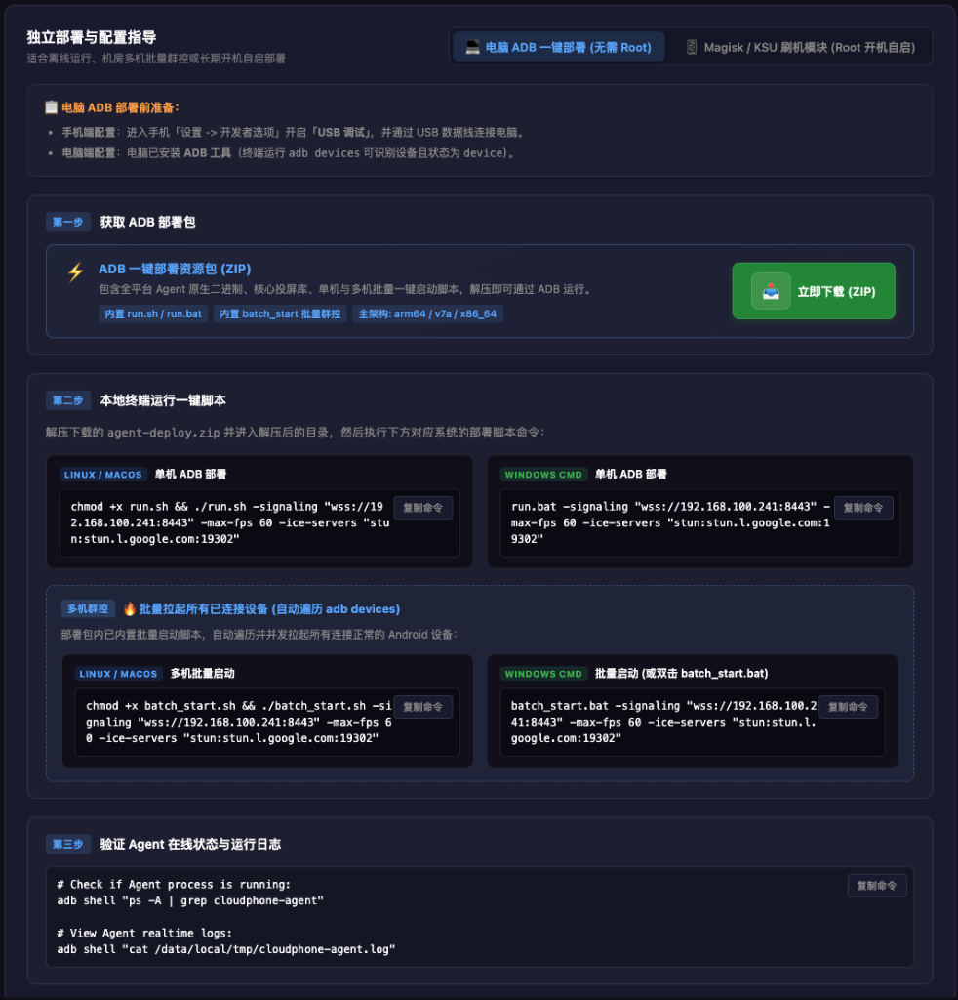
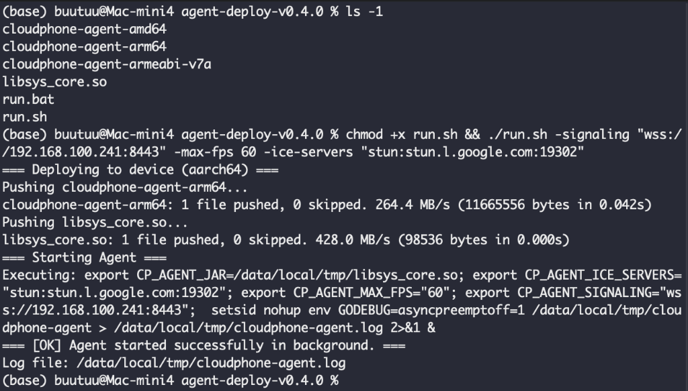

# Method 2: PC ADB Script One-Click Deployment (No Root)

If you are comfortable with terminal commands, need to onboard multiple devices concurrently on a local network, or prefer connecting via **Wireless ADB over TCP/IP**, the official portable deployment package `agent-deploy.zip` provides an automated solution.

> 💡 **Quick Tip**: On the **`/deploy` page** of your web console, or directly at the [Official Download Center (webrtc-phone.com/#download)](https://webrtc-phone.com/#download), you can download this package with one click. The console also **dynamically generates pre-configured deployment commands** for your specific server, allowing you to click **"Copy Command"** and run it immediately in your terminal without typing parameters manually.

---

## 📋 Scenarios & Prerequisites

| Item | Requirement |
| :--- | :--- |
| **Supported OS** | Windows (10/11), macOS (Intel/Apple Silicon), Linux (Ubuntu, Debian, CentOS, etc.) |
| **Prerequisites** | ADB command-line tools installed and accessible via terminal (`adb version` returns valid output) |
| **Connection Type** | Physical USB cable or wireless network connection via `adb connect <PHONE-IP>:5555` |

---

## ⚡ Step-by-Step Instructions

### Step 1: Download Deployment Package & Copy Commands
1. Open the Web Console (e.g. `https://<YOUR-SERVER-IP>:8443` or `http://localhost:8443`).
2. Click **"Deploy"** in the left sidebar (`/deploy`).
3. In the bottom-right **"Standalone Setup & Configuration Guide"** panel under **"PC ADB One-Click Deployment (No Root)"** (shown below):
4. Click the green **"Download Now (ZIP)"** button to get `agent-deploy.zip`, and extract it into any local folder.



Archive directory structure:
```text
agent-deploy/
├── cloudphone-agent-arm64       # Android 64-bit native Agent binary
├── cloudphone-agent-armeabi-v7a # Android 32-bit native Agent binary
├── cloudphone-agent-amd64       # Android x86_64 container/emulator binary
├── libsys_core.so               # Customized scrcpy-server capture engine
├── run.sh                       # Linux / macOS single device deployment script
├── run.bat                      # Windows CMD single device deployment script
├── batch_start.sh               # Linux / macOS multi-device concurrent batch script
└── batch_start.bat              # Windows multi-device concurrent batch script
```

### Step 2: Connect Phone & Verify ADB Status
Ensure USB debugging is enabled on the device, connect it to your PC with a data cable, then run:
```bash
adb devices
```
Confirm your device is listed with status `device`.

*(If using wireless ADB, connect first via `adb connect <PHONE-IP>:5555`)*

### Step 3: Copy Command & Run in Terminal

In **"Step 2: Run Deployment Script Locally"** on the `/deploy` page, the console has already generated commands tailored to your server's IP/domain and ICE settings. Simply click the **[Copy Command]** button and paste it into your terminal inside the extracted directory:

#### Scenario A: Single Device Onboarding (Recommended)

* **Linux / macOS**:
  ```bash
  chmod +x run.sh && ./run.sh -signaling "wss://<YOUR-SERVER-IP>:8443" -max-fps 60 -ice-servers "stun:stun.l.google.com:19302"
  ```
* **Windows (CMD)**:
  ```cmd
  run.bat -signaling "wss://<YOUR-SERVER-IP>:8443" -max-fps 60 -ice-servers "stun:stun.l.google.com:19302"
  ```

#### Scenario B: Multi-Device Concurrent Batch Onboarding

To push to all connected devices in parallel for fleet control:

* **Linux / macOS**:
  ```bash
  chmod +x batch_start.sh
  ./batch_start.sh -signaling "wss://<YOUR-SERVER-IP>:8443" -max-fps 60 -ice-servers "stun:stun.l.google.com:19302"
  ```
* **Windows**:
  Double-click **`batch_start.bat`** to launch the interactive prompt wizard, or run in CMD:
  ```cmd
  batch_start.bat -signaling "wss://<YOUR-SERVER-IP>:8443" -max-fps 60 -ice-servers "stun:stun.l.google.com:19302"
  ```

> 💡 **Parameter Details**:
> - `-signaling <URL>`: Required. Points to the signaling WebSocket server (e.g. `wss://192.168.100.241:8443`).
> - `-max-fps <fps>`: Optional. Maximum stream frame rate (defaults to 60 fps).
> - `-ice-servers <STUN/TURN>`: Optional. WebRTC NAT traversal server (defaults to Google STUN or your private STUN/TURN server).
> - Device ID (`-id`) is auto-detected and assigned by default from device hardware model and serial number; specifying manually is optional.

### Step 4: Verification & Disconnection

Upon execution, the script automatically handles architecture detection, binary push, permission assignment, and detached background execution:



Pipeline breakdown matching the terminal output above:
1. **Architecture Detection**: Automatically detects device ABI (e.g. `aarch64` / `arm64`);
2. **Push Binaries**: Pushes the matching `cloudphone-agent` and `libsys_core.so` engine to `/data/local/tmp/` via ADB;
3. **Daemon Execution**: Grants executable permissions (`chmod 755`) and launches detached via `setsid nohup`, outputting the background PID;
4. The terminal displays `=== [OK] Agent started successfully in background. ===` with the log path `/data/local/tmp/cloudphone-agent.log`.

You can now **safely unplug the USB cable**. Return to the web console "Dashboard" or "Devices" page to see the device online and start controlling!

---

## 🛑 Stop & Terminate the Agent

* **Method 1 (On the device itself)**:
  Open `http://127.0.0.1:12345/d` in the phone's built-in browser to disconnect active sessions or completely kill the Agent process.
* **Method 2 (Via PC ADB command)**:
  Run the cleanup command in your computer's terminal:
  ```bash
  adb shell "pkill -f cloudphone-agent && pkill -f libsys_core.so"
  ```

---

## ➡️ Other Onboarding Options

- [Method 1: WebUSB Browser Setup (Zero Driver)](/en/agent-webusb)
- [Method 3: Magisk / Root Auto-Start Module (24/7 Unattended)](/en/agent-magisk)
- [Method 4: Android App Native Client (On-Device)](/en/app-guide)
