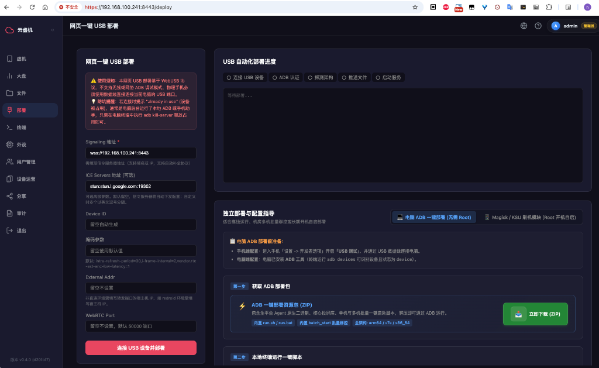
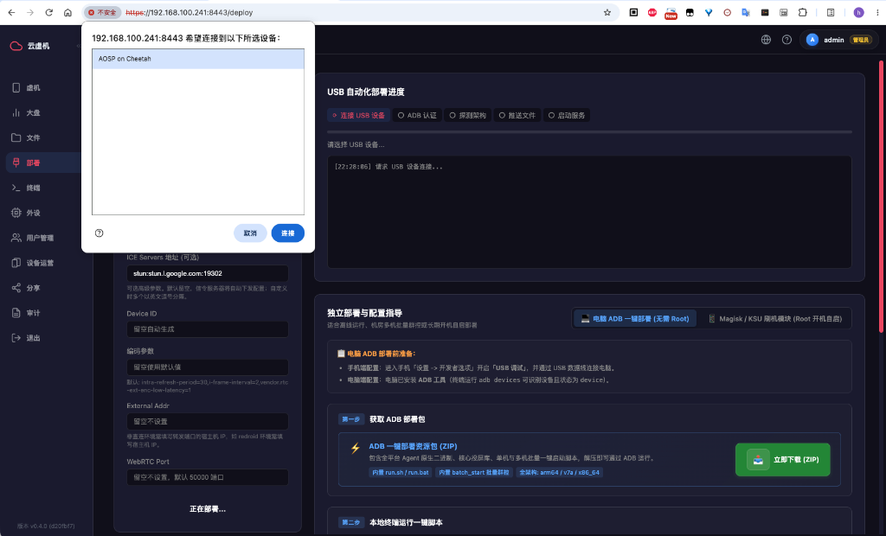
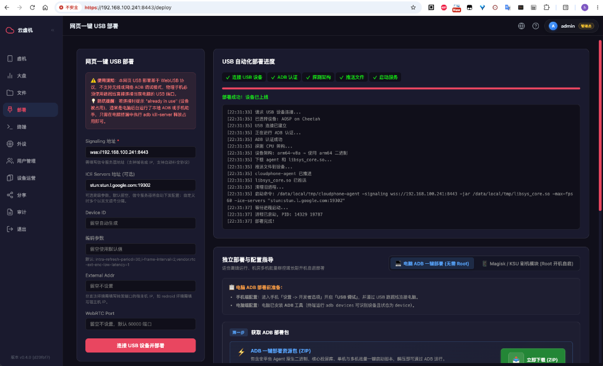

# Method 1: WebUSB Browser One-Click Setup

The web console includes a built-in automated onboarding pipeline based on the modern browser **WebUSB API and pure frontend WebADB**.  
Users **do not need to install Android SDK or configure any ADB drivers on their computer**. Simply open the web console in Google Chrome or Microsoft Edge, plug in the USB cable, and complete automatic device architecture detection, silent deployment, and background execution with a single click.

---

## 📋 Scenarios & Prerequisites

| Item | Requirement |
| :--- | :--- |
| **Supported Devices** | All Android physical devices with USB Debugging enabled (Non-Root supported) |
| **Browser Compatibility** | Google Chrome 89+, Microsoft Edge 89+, or Chromium-based browsers (Safari & Firefox do not support the WebUSB standard) |
| **Network Protocol** | Must access the web console via secure **`https://`** or local **`http://localhost`** (Browser Security Sandbox constraint) |
| **Local ADB Conflict** | Close any third-party Android helper tools, mobile assistants, or emulators running on your computer to avoid USB interface conflicts |

---

## ⚡ Step-by-Step Instructions

### Step 1: Connect Phone to Computer
1. Verify prerequisite device configuration as described in [Device Preparation](/en/agent-prep) (enable USB Debugging and brand security input options).
2. Connect your phone to your PC via a USB data cable.

### Step 2: Open Console Deployment Page
1. In your browser, open the management console (e.g., `https://<YOUR-SERVER-IP>:8443` or `http://localhost:8443`).
2. Click **"Deploy"** in the left sidebar navigation (URL path `/deploy`), entering the **"One-Click WebUSB Deployment"** page.



3. Review configuration parameters on the left (default settings are recommended for most users):
   - **Signaling URL (Required)**: Automatically pre-filled with the current server URL (e.g., `wss://192.168.100.241:8443`). If accessing via reverse proxy or public domain, make sure the address is accessible by the device.
   - **ICE Servers (Optional)**: Defaults to Google STUN (`stun:stun.l.google.com:19302`) for WebRTC NAT traversal. In LAN environments, leave as default.
   - **Device ID (Optional)**: Leave blank to auto-generate a random ID, or enter a readable custom identifier.
   - **Encoding options / External Addr / WebRTC Port**: Advanced tuning parameters. Leave blank to use optimized defaults.

### Step 3: Click "Connect USB Device & Deploy" with Dual Authorization
1. Ensure the phone is physically connected to your computer via USB data cable, then click the pink button **[Connect USB Device & Deploy]** at the bottom left.
2. **Browser WebUSB Authorization**:
   - The button label changes to **"Deploying..."**, the first milestone **"Connect USB Device"** on the right progress panel lights up, and the terminal logs `Requesting USB device connection...`;
   - A native browser WebUSB device picker dialog appears at the top (as shown below);
   - Select your Android phone model from the list (e.g. `AOSP on Cheetah`), and click the highlighted **"Connect"** button.



3. **Phone USB Debugging Authorization**: An **"Allow USB debugging?"** prompt will appear on your phone's screen (often showing RSA key fingerprint). Check **"Always allow from this computer"** and tap **Allow**.

> 💡 **Troubleshooting USB Conflicts**: If an error like `The device is already in use by another program` or `Unable to claim interface` appears, an active ADB daemon or third-party phone manager is locking the port. Run `adb kill-server` in your terminal and close any phone management software, then click Deploy again.

### Step 4: Fully Automated Deployment Pipeline (Zero Second-Click)
Once authorized, the deployment runs completely unattended. The **"USB Automated Deployment Progress"** panel on the right will light up each of the 5 milestone indicators:
1. **Connect USB Device**: Establishes underlying WebUSB physical data transport;
2. **ADB Authentication**: Completes WebADB protocol authentication & handshake;
3. **Detect Architecture**: Automatically inspects device CPU ABI (e.g. `arm64-v8a`, `armeabi-v7a`, `amd64`);
4. **Push Files**: Pulls the matching `cloudphone-agent` binary and `libsys_core.so` screen mirroring core from the signaling server, writing to `/data/local/tmp/`;
5. **Start Service**: Sets executable permissions (`chmod 755`) and executes `setsid nohup` in Android background detached from terminal to launch Agent and register with signaling server.

The black log terminal displays real-time execution outputs. When all 5 milestones turn green with checkmarks, the progress bar reaches 100%, and the green status displays **"Deployment Successful! Device is Online"**, the entire onboarding is complete.



### Step 5: Disconnect Cable & Control Wirelessly
1. The Agent is now running independently as a background daemon on the phone.
2. You can now **safely unplug the physical USB cable**.
3. Click **"Dashboard"** or **"Devices"** in the left sidebar; your newly onboarded phone card is online. Click to start ultra-low latency WebRTC remote streaming and control!

> 💡 **On-Device Emergency Disconnect**: After unplugging the cable, if you want to immediately sever the remote session directly on the phone, open `http://127.0.0.1:12345/d` in the phone's mobile browser to disconnect active sessions or terminate the Agent daemon.

---

## ❓ Troubleshooting

**Q: Error: "The device is already in use by another program" or "Unable to claim interface"?**
- **Cause**: WebUSB requires exclusive access to the device's physical USB endpoint. If an active local `adb server` process is running on your host machine (e.g., Android Studio, VS Code debugging tools, Android emulators, or OEM suites), it locks the USB interface.
- **Solution**:
  1. Open a terminal on your computer (Windows: `Win+R` -> `cmd`; macOS: `Terminal`);
  2. Kill the local ADB daemon:
     ```bash
     adb kill-server
     ```
  3. Close any third-party phone assistants in your system tray;
  4. Return to your browser and click **"Connect & Authorize Device"** again.

**Q: My phone is not listed in the browser USB popup?**
1. Check that the USB cable is firmly seated and try a different USB port (motherboard rear ports recommended for desktops).
2. Check if the phone prompted for authorization, and confirm Developer Options & USB Debugging are enabled.
3. Terminate local ADB daemons with `adb kill-server`.

**Q: Deployment succeeded, but the device never appears online?**
1. Ensure the phone's Wi-Fi network can reach the signaling server IP and port (`8443`).
2. Verify that no VPN or proxy on the phone is routing internal traffic away.
3. Xiaomi users: Confirm that **"USB Debugging (Security settings)"** is enabled.

---

## ➡️ Other Onboarding Options

- [Method 2: PC Script One-Click Deployment (Wired/Wireless ADB)](/en/agent-script)
- [Method 3: Magisk / Root Auto-Start Module (24/7 Unattended)](/en/agent-magisk)
