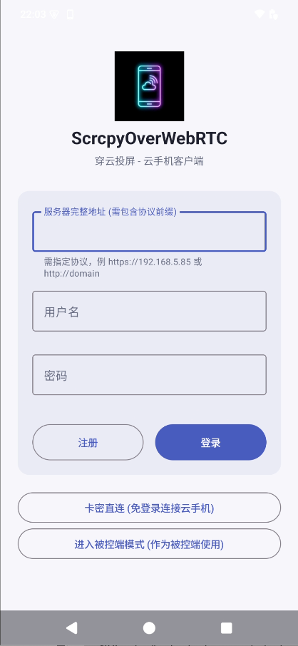
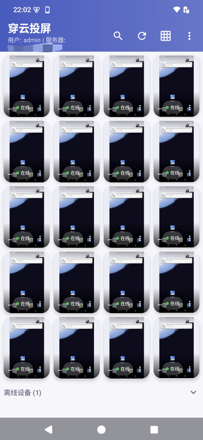
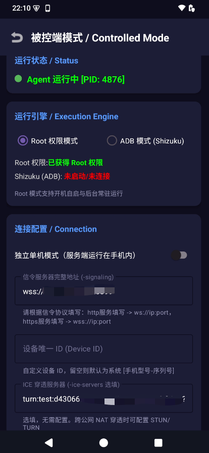
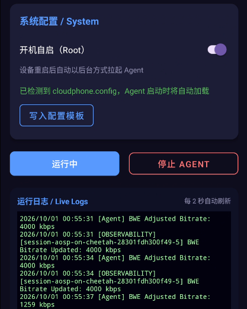

# Method 4: Android App Native Client

The official native Android client (code-named `WebrtcTest`) combines both **Controller (Master)** and **Agent Host (Managed)** capabilities into a single application, allowing you to manage and control devices directly from Android phones and tablets, or turn any phone into a remote cloud phone without a computer.

* **Controller Mode**: Sign in to the signaling center from your mobile device to inspect matrix overviews and operate remote devices with responsive low-latency controls; supports passcode quick access.
* **Agent Host Mode**: Launch the Agent daemon directly on the device using either **Root elevation** or **Shizuku (Non-Root ADB)** without needing a PC. Enabling Standalone Mode runs the signaling server and web console directly inside the phone itself.

---

## 📥 App Installation

Download the latest CloudPhone App (`.apk`) from the [Releases](https://github.com/hqw700/ScrcpyOverWebRTC/releases) page and install it on your Android device.

> 💡 **Zero External Dependencies**: The app bundles precompiled native Agent binaries and screen mirroring components for all architectures (`arm64`, `armeabi-v7a`, `x86_64`). No files need to be pushed from a PC.

---

## 🎮 1. Controller Mode: Operate Remote Devices from Android

### 1. Login & Connection

Launch the app to access the login and entry portal (shown below):



1. **Standard Account Sign-In**:
   - **Server Address**: Include the protocol scheme (e.g. `https://192.168.100.241:8443` or your custom domain);
   - **Credentials**: Defaults to `admin` / `admin123` (shared with the Web Console, or tap "Register" to create a new tenant account);
   - Tap **"Sign In"** to authenticate.
2. **Quick Entry Portals**:
   - **Passcode Direct Access**: Tenants or users can enter an 8-character passcode (e.g. `CP-XXXX-XXXX`) to control an assigned cloud device directly without registering or logging in;
   - **Switch to Host Mode**: Turn the current phone into a managed cloud device directly without signing in as a controller.

### 2. Mobile Matrix Overview & Device Grid

Upon authentication, the mobile-optimized real-time device monitoring grid appears:



- **High-Density 4-Column Matrix**: View live video previews and green online badges across all cloud devices concurrently;
- **Quick Action Toolbar**: Search by device name/tag (🔍), one-tap refresh (🔄), toggle grid layouts (田), and access settings;
- **Status Grouping**: Collapse or expand the offline device roster at the bottom;
- **Instant Control**: Tap any online device card to establish an immediate WebRTC peer connection and open the touch control interface.

### 3. Low-Latency Controls
Inside the interactive control view:
- **Multi-Touch & Coordinate Inversion**: Responsive pinch-to-zoom and multi-finger gestures. Dynamic display rotation triggers OpenGL 90° orientation adjustment with inverse coordinate mapping.
- **Latency Indicator Pill**: Calculates end-to-end latency dynamically based on RTT, Jitter Buffer delay, and decoding time, color-coded as `<50ms` (green), `<100ms` (yellow), and `>100ms` (red).
- **Navigation & Hardware Keys**: Floating controls provide Back, Home, and Recents navigation, alongside Power and Volume buttons.
- **IME Text Injection**: Characters are injected atomically upon word completion; virtual physical keyboard registration suppresses annoying remote software keyboards from covering the screen.
- **Camera Passthrough**: Send your mobile device's camera stream back to the cloud phone via WebRTC for virtual camera drivers.

### 4. Background Keepalive & Auto-Healing
When minimizing the controller app, the singleton connection manager maintains a 10-minute keepalive session. Video decoding is paused in the background and resumes immediately upon returning to the foreground; network disconnections trigger silent auto-reconnects.

---

## 📲 2. Agent Host Mode: Turn Phone into a Remote Cloud Device

Tap **"Switch to Host Mode"** on the login or dashboard page to register the current physical phone as a managed cloud device, accessible from PCs or other mobile phones.



### 1. Select Execution Engine

| Engine | Target Devices | Architecture & Permissions |
| :--- | :--- | :--- |
| **Root Mode** | Rooted devices (Magisk / KernelSU / APatch) | Elevated via `su`, **supports boot auto-start, persistent daemon watchdog, and offline batch configuration file loading** |
| **ADB Mode (Shizuku)** | **Unrooted standard devices** | Runs via Shizuku as `shell` (UID 2000), natively equipped with screen recording and touch injection **without Root** |

> 💡 **Shizuku Setup**: Install [Shizuku](https://shizuku.rikka.app/) (Android 11+ pairs via Wireless Debugging without a PC); select "ADB Mode (Shizuku)" in the app and grant permission.

### 2. Root Mode: Boot Auto-Start & Batch Config File



For server rack deployments or long-term unattended clusters, Root mode delivers two essential capabilities:

#### ① Boot Auto-Start (Root)
Toggle on **"Auto-Start on Boot (Root)"** under the "System / System" panel:
- Every time the phone boots or reboots, the background system service **automatically launches the Agent and registers with the signaling server**;
- No USB cables, PC commands, or manual app touches required—enabling true 24/7 autonomous operation.

#### ② Batch Configuration File (`/data/local/tmp/cloudphone.config`)
To eliminate repetitive manual IP entry across dozens of phones, the app natively loads offline config templates:
- **On-Device Template Creation**: Tap **[Write Config Template]** to generate the configuration file on disk. The UI displays in green: `cloudphone.config detected, Agent will load it automatically on startup`;
- **Automated Fleet Provisioning**: During initial setup, push the config file directly to the device path:
  ```text
  /data/local/tmp/cloudphone.config
  ```
  Sample format:
  ```bash
  CP_AGENT_SIGNALING="wss://192.168.100.241:8443"
  CP_AGENT_ICE_SERVERS="stun:stun.l.google.com:19302"
  CP_AGENT_ID=""
  ```
  When present, the Agent prioritizes these settings on startup, allowing dozens of phones to onboard silently and automatically.

### 3. Parameters & Manual Launch
1. **Signaling Server URL**: Enter your signaling endpoint (e.g. `wss://192.168.100.241:8443`);
2. **Device ID**: Custom display name (leave blank to auto-detect `[Model-SerialNumber]`);
3. **ICE Servers**: Optional STUN/TURN server for traversal across public NATs;
4. Tap **"Start Agent"**.

The top status banner turns green: **`Agent Running [PID: xxxx]`**, and "Live Logs" auto-refreshes every 2 seconds with WebRTC and BWE dynamic bitrate statistics. Your phone is immediately controllable from the web console.

---

## 🏠 3. Standalone Mode: Self-Contained Server on Phone

Check **"Standalone Mode"** in the Host interface to run the signaling server (`webrtc-signaling`) and web console directly inside the phone:

1. Connect the phone to local Wi-Fi, then tap **"Start Server & Agent"**;
2. The UI displays the local IP and **HTTPS Web URL** (e.g. `https://192.168.1.120:8443`);
3. Any computer, tablet, or phone on the same Wi-Fi network can open that URL in a browser to control this phone, **requiring zero external servers or PCs**.

---

## ❓ Troubleshooting

**Q: Agent disconnects when the app is placed in the background?**
Aggressive battery optimizations in certain Android ROMs may kill background services. Add CloudPhone to your device's **"Battery Optimization Whitelist"** and enable **"Allow Background Autostart"**. For 24/7 unattended operation, the [Magisk Module](/en/agent-magisk) is strongly recommended.

**Q: Are there security notifications while remotely controlled?**
Per Android security guidelines, a persistent screen recording indicator appears in the system notification shade during mirroring sessions.
