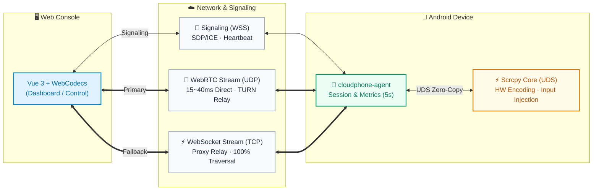
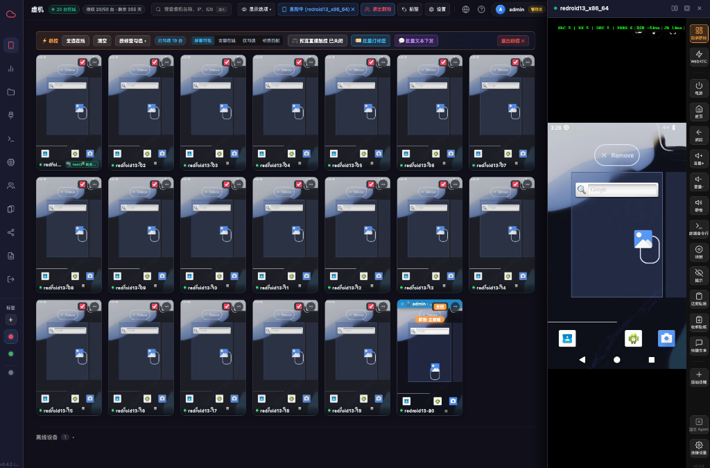
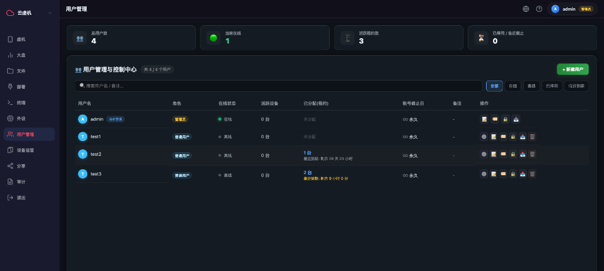
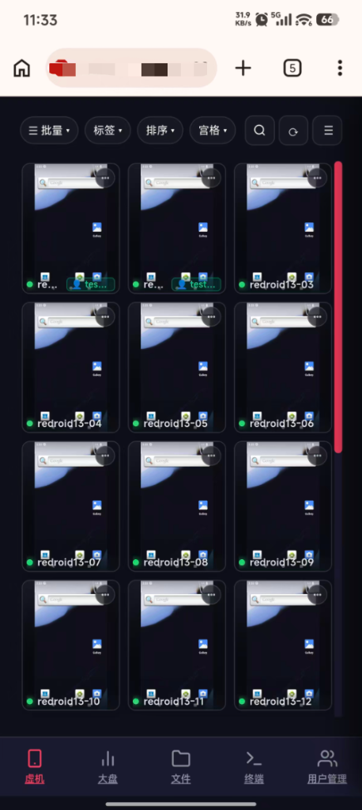
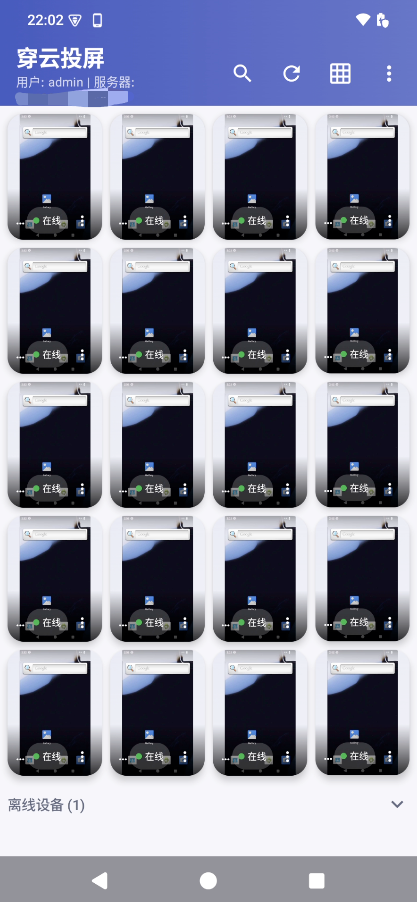
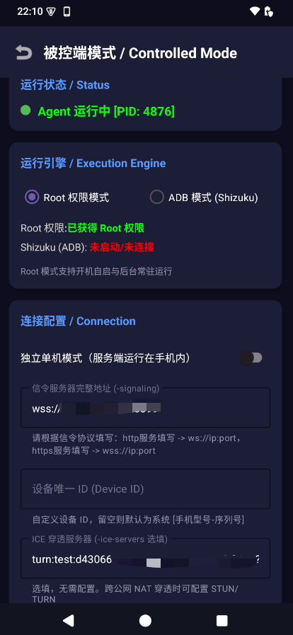

# Introduction & Architecture

ScrcpyOverWebRTC is an enterprise-grade **Web-based remote Android device management platform** optimized for ultra-low latency, real-time touch interaction, and large-scale device matrix operations.

By delegating media encoding and stream packetization directly inside the Android device, the system eliminates heavy centralized server transcoding, achieving a lightweight architecture with immediate responsiveness.

---

## 🖼️ Multi-Terminal UI Showcase

### 1. Desktop Web Console (Matrix Fleet Control & Direct Workspace)
Supports real-time high-fps matrix preview across dozens or hundreds of devices, top-mounted fleet control tools, and a right-side direct control drawer:

### 2. Desktop Web Console (Multi-Tenant & User Management)
Granular user role assignments, precise device allocation by time-based lease (minutes/hours/days/permanent), active session tracking, and comprehensive operation audit logs:

### 3. Mobile Web Console (Responsive Adaptation)
Optimized for mobile and tablet touch browsers, adapting into an immersive high-density layout with batch fleet filtering and native bottom navigation:

  

### 4. Native Android App (Dual Client & Host Manager)
Integrated dual-mode Android App that operates as a high-performance WebRTC client controller or as an on-device host agent (Root / Shizuku non-root) to keep physical phones online standalone:

  
  

---

## 🎯 Core Design Principles

1. **Ultra-Low End-to-End Latency**: Through customized WebRTC and zero-copy streaming pipelines, interactive delay ranges between **15ms ~ 40ms**, delivering native-feeling responsiveness.
2. **Dual-Track Connectivity (WebRTC + WebSocket)**: Seamlessly combines ultra-low latency WebRTC P2P streaming with robust 100% TCP WebSocket streaming to bypass strict enterprise firewalls.
3. **Zero Central Transcoding Overhead**: Media streams flow directly between the browser and Android device. The central server performs lightweight signaling and data forwarding without consuming server CPU/GPU transcoding cycles.
4. **Unified Multi-Form Management**: Unified management across physical devices (USB/Wi-Fi/Root/Non-Root), Docker `redroid` cloud containers, local emulators, and customized ROMs.
5. **Comprehensive Feature Suite**: Matrix real-time preview, direct preview touch, visual keymapping, 100% full IME Chinese/text injection, P2P file management, WebADB terminal, multi-tenant roles, and security audit logs.

---

## 🔬 Key Architecture Highlights

### 1. Dual-Track Connectivity: WebRTC (UDP) & WebSocket (TCP)

To balance ultra-low latency with reliable firewall traversal across diverse network environments, the system features a dual-track connection architecture:

| Connection Mode | Transport Protocol | Typical Latency | Key Strengths & Recommended Scenarios |
| :--- | :---: | :---: | :--- |
| **🚀 WebRTC Direct Mode (Default)** | UDP (IPv4 / IPv6) | **15ms ~ 40ms** | Prioritizes direct P2P streaming with GCC congestion control. Automatically falls back to coturn TURN relay on NAT traversal failure. |
| **⚡ WebSocket Streaming Mode (TCP)** | TCP (WSS / WS) | **40ms ~ 80ms** | **100% Traversal Reliability**. Designed for restricted enterprise firewalls, campus networks, or networks blocking UDP. Multiplexes over HTTP/HTTPS ports. |
| **📺 WebSocket Matrix Preview** | TCP (WebSocket Binary) | Dynamic (5~15 FPS) | Distributes lightweight H.264 video streams with viewport-aware lazy loading, enabling 100+ simultaneous screen monitoring sessions and direct dashboard touch. |

### 2. Unix Domain Socket (UDS) Isolation
- Android-side communication between `cloudphone-agent` and `scrcpy-server` uses Linux local sockets (Unix Domain Socket, zero TCP/IP overhead).
- Sockets are separated into three dedicated channels:
  - **Video Channel**: Clean H.264 Annex B stream;
  - **Audio Channel**: Opus encoded audio packets;
  - **Control & Touch Channel**: Low-latency binary input events.
- **Advantage**: Even during instantaneous high-bitrate video traffic, control and touch inputs travel through dedicated channels without queuing.

### 3. Viewport-Aware High-Frequency Preview with WebCodecs GPU Decoding
- The dashboard discards legacy CPU JPEG compression in favor of lightweight raw H.264 video streams.
- The browser leverages modern **WebCodecs API (`VideoDecoder`)** to decode video directly on local GPUs onto `<canvas>`, minimizing RAM and CPU usage.
- Integrated with `IntersectionObserver`: high-frequency streaming (5~10 FPS) only activates when a device card scrolls into view, automatically throttling when offscreen to effortlessly sustain dozens of concurrent devices.

---

## ➡️ Next Steps

- Explore full capability list: [Core Feature Matrix](/en/features)
- Hardware planning & decisions: [Hardware & Architecture](/en/quickstart)
- Connect your first device: [Device Preparation & Matrix](/en/agent-deploy)
