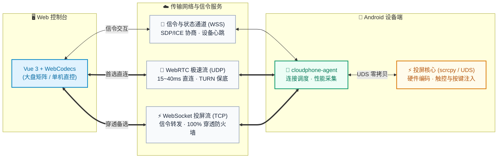
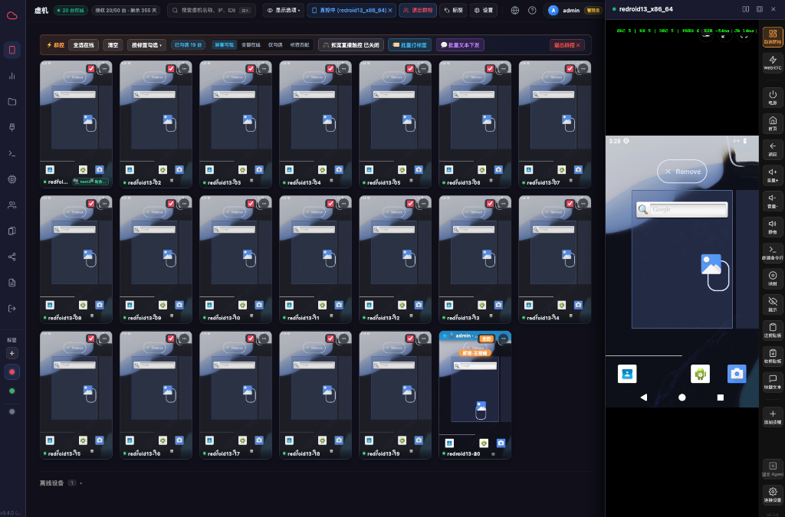
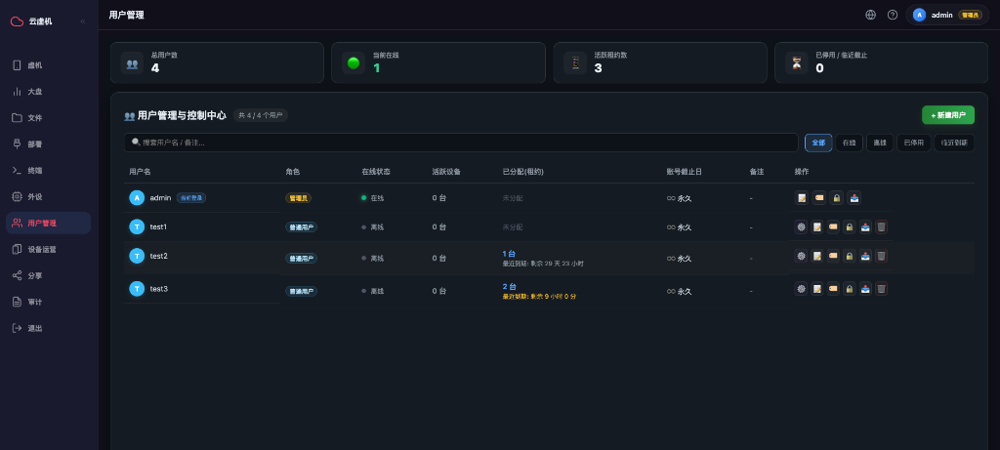
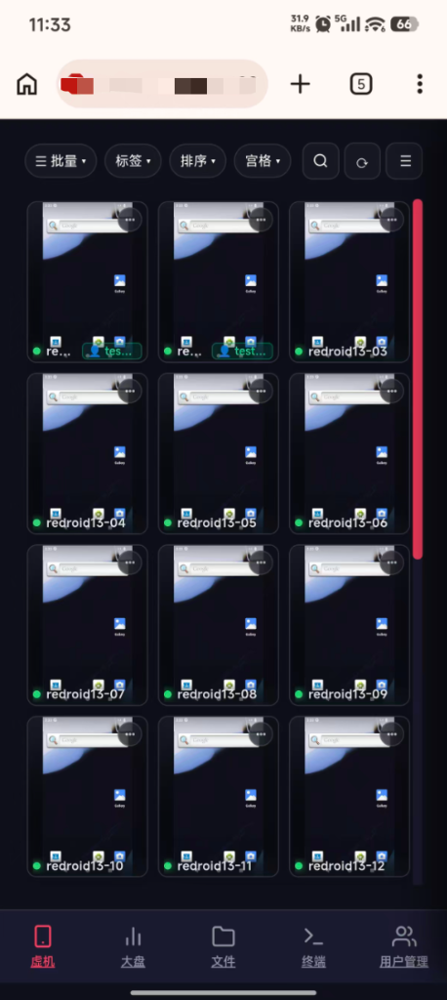
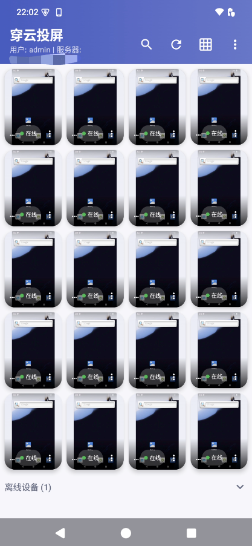
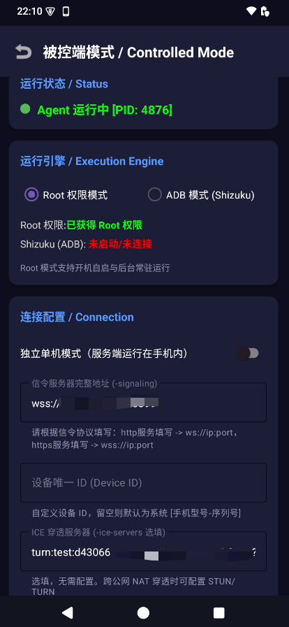

# 项目简介与系统架构

ScrcpyOverWebRTC（穿云投屏）是一款面向超低延迟、高频交互与大规模设备纳管场景的 **Web-based 远程 Android 云手机管理系统**。

系统通过将媒体控制下沉至 Android 设备内部，避免了传统方案中繁重的中心服务器转码与二次转发，实现了极轻量、极高响应速度的设备中心控制台。

---

## 🖼️ 多端全景交互呈现 (UI Showcase)

### 1. 桌面 Web 控制台 (大盘矩阵群控与直控工作台)
支持数十乃至上百台设备同屏高频实时预览，顶部常驻群控与批量下发工具栏，右侧无缝呼出单机直控工作台与控制侧栏：

### 2. 桌面 Web 控制台 (用户管理与多租户控制中心)
支持细粒度用户角色划分、设备按时长租约（精确至分钟/小时/天/永久）精准分配、设备活跃占用追踪与全流程操作审计：

### 3. 手机移动网页端 (响应式自适应)
针对手机/平板触屏浏览器深度优化，自动转为沉浸式高密布局，支持顶部批量群控筛选与底部原生导航栏切换：

  

### 4. Android 原生 App 双端客户端
集成双功能的原生 Android App，既可作为 WebRTC 客户端秒级主控，亦可作为被控端通过 Root 或免 Root (Shizuku) 模式使物理手机脱离电脑独立常驻受控：

  
  

---

## 🎯 核心设计目标

1. **极致超低延迟**：通过 WebRTC 深度定制与零拷贝媒体管线，操作端到端延迟通常在 **15ms ~ 40ms** 以内，手感对标原生 scrcpy。
2. **双轨连接保障 (WebRTC + WebSocket)**：既具备 WebRTC UDP 点对点直连的极致低延迟，又具备 WebSocket 100% TCP 强穿透能力，无惧企业防火墙封锁。
3. **零中心转码损耗**：媒体流与控制信号直接在浏览器与手机之间直通，中心服务器仅做轻量信令交换或透明数据透传，不消耗服务端 CPU/GPU 算力。
4. **多终端多形态纳管**：统一纳管物理真机（USB/Wi-Fi/Root/免Root）、Docker `redroid` 容器云手机、模拟器以及定制 ROM。
5. **全功能开箱即用**：内置大盘高频预览、独立预览直控、按键映射、100% 汉字落屏输入法、P2P 文件管理、WebADB 调试、多用户租户与审计日志。

---

## 🔬 关键技术原理

### 1. WebRTC (UDP) 与 WebSocket (TCP) 双轨连接架构

为了兼顾「极致延迟」与「全网穿透稳定性」，系统实现了双轨连接引擎，支持秒级无缝切换：

| 连接模式 | 传输协议 | 典型端到端延迟 | 核心优势与适用场景 |
| :--- | :---: | :---: | :--- |
| **🚀 WebRTC 直连模式 (默认首选)** | UDP (IPv4 / IPv6) | **15ms ~ 40ms** | 优先 P2P 点对点穿透，音画超低延迟；支持 GCC 弱网拥塞控制；NAT 打洞失败时自动无感降级至 coturn TURN 中继。 |
| **⚡ WebSocket 投屏模式 (TCP 穿透)** | TCP (WSS / WS) | **40ms ~ 80ms** | **100% 穿透能力**。专为受限企业防火墙、校园网、禁用 UDP 或海外复杂公网环境设计。直接复用 HTTP/HTTPS 端口经信令反代转发，彻底根治“只连不上”的痛点。 |
| **📺 WebSocket 大盘矩阵预览** | TCP (WebSocket 二进制) | 动态帧率 (5~15 FPS) | 采用轻量 H.264 独立编码流分发，滚动视口感知加载，支持百机同屏监控与免建连「大盘直接触控」。 |

### 2. Unix Domain Socket (UDS) 三通道物理隔离
- Android 端 `cloudphone-agent` 与 `scrcpy-server` 之间的进程通信使用 Linux 本地套接字（Unix Domain Socket，零网络协议栈拷贝）。
- 通信链路在物理上划分为独立的三大通道：
  - **视频通道 (Video UDS)**：传输纯净 H.264 Annex B 裸流；
  - **音频通道 (Audio UDS)**：传输 Opus 编码音频流；
  - **控制与触控通道 (Control UDS)**：传输高优先级触控事件与设备控制指令。
- **优势**：即使在视频大码率瞬时拥塞的高负载状态下，触控指令仍通过独立的控制通道瞬间送达并执行，杜绝操作指令排队等待。

### 3. 视口感知高频预览与 WebCodecs GPU 硬解
- 大盘监控页抛弃了传统 CPU 压缩 JPEG 图片的低效方案，直接采用低分辨率 H.264 视频裸流分发。
- 浏览器利用现代 **WebCodecs API (`VideoDecoder`)** 直接调用本地 GPU 进行硬件解码，渲染到 `<canvas>` 画布上，内存与 CPU 开销大幅降低。
- 结合 `IntersectionObserver` 视口监听：仅对滚动到屏幕可见区域内的设备激活高频预览（5~10 FPS），滚出可视区自动降级，有效支撑数十乃至上百台设备同屏监控。

---

## ➡️ 下一步推荐

- 查看系统完整能力清单：[核心功能全景特性](/features)
- 查看硬件要求与部署路线：[硬件要求与选型决策](/quickstart)
- 开始接入第一台设备：[设备准备与全景选型指南](/agent-deploy)
